# State machines in secondary-api-recovery (Second Brain API)

Last reviewed: 2026-11-11 at `5d147727b70c0c5f7af08128f3377e88354735b2`

Standard: Implicit state machine standard v1 (2026-11-11), sha256 `c62dff48dc032e70df170c3161709ae7bfb79f1e25db473b730a300cedb82f0c`. No XState or other state-machine dependency. A plain reducer is the intended fix shape.

This repository is the recovered Secondary API Worker plus shared policy and contracts packages. It is not the static UI, not a LaunchAgent, and not the connector, ops, audit, or MCP workers. `recovered-source/` is byte-checked against `candidate-manifest.json` by `harness/tests/intake.test.ts`. This commit does not change those bytes. Later Low and Medium fixes, if they patch a recovered file, must keep the manifest as the intake record and list the patched path in that test. Canonical note text in `recovered-source/worker/src/wiki/seed-content.ts` stays untouched.

Risk used here:

- **High** — a wrong transition changes who is signed in, who may approve, what is published, or whether a signed call can be replayed. Not fixed on this branch. Waiting on review of this inventory.
- **Medium** — a real lifecycle whose failure is a duplicate dev seed, a double token settle, a wrong agent-round branch, or a bad stream frame. Decision: fix after this commit, one machine per commit.
- **Low** — a retry decision with no privilege effect. Decision: fix after this commit.

Status in the table matches the code on this branch. Devin approved this inventory with changes at `b527a8de`. High-risk rows stay LATER, except #13, whose guard now refuses a seen key after expiry, #6, whose login record is now one-shot, #4, whose second-person check is now one typed result, #7, whose release status is now a guarded transition, #5, whose stored flag accepts only 0 and 1, #2, whose start writes only a pending row, and #3, whose reopen and decision write only the status the table allows, and #12, whose member write names the state it read, and #9, whose save of an archived page is refused. The order and the right-sizing notes are in the review section below. Step 0 pinned the other High-risk behaviour in `harness/tests/characterization.test.ts` and did not change it.

## Inventory

| # | Machine | Location | Status | Risk | Decision | Notes |
|---|---|---|---|---|---|---|
| 1 | Governance change | `src/state/governance.ts`, `readGovernance`, `toChange` `admin/store.ts`, `propose`, `decide`, `withdraw` predicate | FIXED | High | FIX now | Approve, reject, and withdraw write only a pending row. A pending row past its expiry reads as expired and is not written back. An unknown stored word reads as unknown and has no effect. A lost decision is 409 and does not apply. The duplicate lookup at `admin/store.ts` is a second clock comparison (`expires_at > ?`) and does not write. |
| 2 | Elevation window | `src/state/elevation.ts`, `startElevation` in `admin/store.ts`, predicate, `decideElevation`, approve route `admin/routes.ts` | FIXED | High | FIX now | A start is legal only from pending. The update requires `status = 'pending'` and one changed row. A lost start is 409. Pending and active still expire only when read. `effectiveStatus` in `src/state/elevation.ts` is the only clock comparison. An active row with a null `until`, and any unknown status word, read as expired and are not written back. |
| 3 | Access request | `src/state/access-request.ts`, `markApproved` `admin/store.ts`, `denyRequest`, `reopenRequest`, `afterDecision`, routes | FIXED | High | FIX now | Reopen is legal only from approved. A decision writes only a pending row. A fulfilling change writes only a pending or approved row. A lost race is 409 and does not notify. |
| 4 | Second-person confirmation | `src/state/quorum.ts`, `requestSecond` in `tenant-policy.ts` | FIXED | High | FIX now | Typed result. The requester cannot confirm. A lost confirm is `replay` and does not apply. Callers: kill switch, field exposure, brain open, brain role, export, erasure, restore, and workspace release (#7). Wiki proposal review counts distinct approvers and does not call this. |
| 5 | Kill switch | `src/state/kill-switch.ts`, `setSwitch` in `tenant-policy.ts`, `journal.switchSet`, pending-ask delete in `replay` in `security-journal.ts`, names in `switches.ts` | FIXED | High | FIX now | Off is immediate, and an off journal replay clears the pending ask. On in prod waits for a second person. Replay and a quorum refusal are 409. A stored value other than 0 or 1 stays off. An unknown stored name is skipped by `switchState` in `tenant-policy.ts`. |
| 6 | OIDC login | `authRoutes` in `auth/routes.ts` | FIXED | High | FIX now | Login record is one-shot. Every terminal callback consumes the row. |
| 7 | Workspace item release | `src/state/item-release.ts`, `workspace.ts` `update` and `approve` | FIXED | High | FIX now | `update` rejects a status outside the allow-list, including `approved`. A record status still updates. Release uses the shared quorum result, then one conditional status write. The loser is `replay` and does not emit `item.released`. |
| 8 | Wiki proposal review | `distinctApprovers` `src/state/proposal-review.ts`, `transitionProposal`, `wikiDecide` `wiki/store.ts`, reject, dismiss, approve, and resolve in `wikiDecide`, `wikiEditProposal` | FIXED | High | FIX now | Includes #10. A short approval stays `candidate` while the response says `pending`. Reject, the last approval, and an edit compare the previous status. An unknown word writes nothing. A finding changes only from `open`. Approval counts distinct person ids and does not read a clock. |
| 9 | Wiki page visibility | `src/state/page-visibility.ts`, `savePage` `wiki/store.ts`, `unarchivePage`, archive loop, refusal `wikiDecide` | FIXED | High | FIX now | A save publishes a missing page and rewrites a published page. An archived page is not saved. Unarchive is its own event. An unknown status writes nothing. A lost race is `replay` and does not write a revision. The decide route returns that refusal, which is 409. |
| 10 | Wiki finding | `transitionFinding` `src/state/proposal-review.ts`, insert `wiki/store.ts`, dismiss , resolve | FOLDED | High | part of #8 | `open` / `dismissed` / `resolved` are effects of proposal review. A write matches `status = 'open'`. |
| — | Dev seed approval | `wikiPropose` in `wiki/store.ts` (`WHERE id = ?` only) | NOT A MACHINE | — | NOT A MACHINE | Dev seed. The approval write is not a review machine. |
| 11 | Brain import outcome | `publishMode` `src/state/import-outcome.ts`, `transitionImport`, import `brains/data.ts`, compare-and-set `wiki/store.ts` | FIXED | High | FIX now | A personal auto-accept stays a draft. The dry run and the real import share `publishMode(false)`. Publishing is explicit and updates `WHERE status = 'candidate'`. An unknown word writes nothing. |
| 12 | Brain member | `src/state/brain-member.ts`, `grantsMemberRole`, `brainRoleOf` `brains/store.ts`, claim key `brains/store.ts`, `brainMemberDropClaim`, `brainMemberFinishProposal`, `brainMemberRelease`, `reconcileBrainMember`, `placeScopedMember`, `propose` `admin/store.ts`, `claim_key` column, unique index, `changeByKey`, `reconcileStoredMembers` `brains/open.ts`, route 409 `brains/routes.ts` | FIXED | High | FIX now | A claim mints an opaque key before `gov.propose`. The same key returns the existing change. Only an active row grants a role. A read during propose changes nothing. Applied finishes the claim. Pending or a missing governance row leaves it. Rejected, expired, or withdrawn releases it by key and previous state. |
| 13 | Replay nonce | `nonceFirst` in `tenant-policy.ts` | FIXED | High | FIX now | Named guard, not a reducer. Expiry does not reopen a key. `expires_at` is strictly after the last accepted millisecond. Prune is outside the guard, and only for `expires_at < now`. |
| 14 | Model-call retry | `src/state/model-call.ts`, wired from `ai/anthropic.ts` | FIXED | Low | FIX now | Bounded retry. In-flight calls are not persisted. |
| 15 | Stream-open retry | `src/state/stream-open.ts`, wired from `agent/stream.ts` | FIXED | Low | FIX now | One retry, and only before the body is read. |
| 16 | Token-budget hold | `src/state/budget-hold.ts`, wired from `ai/budget.ts` | FIXED | Medium | FIX now | A second settle is rejected and does not adjust the counter. |
| 17 | Token-counter CAS retry | `src/state/budget-cas.ts`, wired from `ai/budget.ts` | FIXED | Medium | FIX now | Six attempts, then give up. Cap failure does not retry. |
| 18 | Wiki seed claim | `src/state/wiki-seed.ts`, wired from `tenant-policy.ts` and `wiki/seed.ts` | FIXED | Medium | FIX now | Dev only. An unexpired claim now blocks every version. Completing cannot move backwards. |
| 19 | Agent turn round | `src/state/agent-turn.ts`, wired from `agent/loop.ts` | FIXED | Medium | FIX now | Stop reason, budget, and the last-round tool ban are one reducer. |
| 20 | SSE content assembly | `src/state/sse-assembly.ts`, wired from `agent/stream.ts` | FIXED | Medium | FIX now | Frame order is one reducer. A bad frame still fails the round. |
| 21 | Home screen adaptive UI | not in this repo | NOT A MACHINE | — | NOT A MACHINE | Static UI was not recovered. See below. |
| 22 | Recorder / LaunchAgent | not in this repo | NOT A MACHINE | — | NOT A MACHINE | No matches. See below. |
| 23 | Calendar refresh | not in this repo | NOT A MACHINE | — | NOT A MACHINE | No refresh lifecycle. See below. |
| 24 | Coverage and account health | `accountStatus` and `brainCoverage` in `brains/insights.ts` | NOT A MACHINE | — | NOT A MACHINE | Pure thresholds. No events. |
| 25 | AI processor gate | `aiState` in `ai/config.ts` | NOT A MACHINE | — | NOT A MACHINE | Already a discriminated union, recomputed from env. |
| 26 | Import classifier | `uxv2/classifier.ts` | NOT A MACHINE | — | NOT A MACHINE | Pure verdict. The import machine is #11. |
| 27 | Connector upsert | `connectorRoutes` in `connector.ts` | NOT A MACHINE | — | NOT A MACHINE | Request handlers. No connection lifecycle in this repo. |
| 28 | Session-report publish flag | `pushRoutes` in `brains/push.ts` | NOT A MACHINE | — | NOT A MACHINE | One boolean, one condition, no further states. |
| 29 | Wiki job queue | `MAX_ATTEMPTS` and `wikiJobsDue` in `wiki/store.ts` | LATER | Medium | LATER | `pending` / `running` / `failed`, plus `done` and `cancelled`. A claim older than five minutes returns to `pending`, or `failed` after 3 attempts. An ingest job with no subject is failed and not claimed. |
| 30 | Erasure / rights | Request machine `transitionErasure` `src/state/erasure-request.ts`. Grant check `erasureGrantOk`. Entry `opsAdminRoutes` in `ops-admin.ts`. Grant write `erasureSaveAtomic` in `tenant-policy.ts`. Record `erasureSave` in `tenant-policy.ts`. Tombstone write `tombstoneAdd` in `tenant-policy.ts`. Receipt scan `pseudonymiseReceipts` in `audit.ts`. Re-apply `reapplyErasures` in `ops-rights.ts` | LATER | High | LATER | The request ledger, the tombstone write, and the receipt scan are in. The other erasure paths stay later. A row resumes only with a grant from two distinct people that covers every plan step. A missing grant, a damaged ledger, and an unknown step are `unreadable`. Database write access is outside the threat model. The grant defends against damaged, legacy and partial rows, not against a DB writer. A live tombstone is left alone. An expired one takes the new expiry and keeps its other columns. The clock is the `now` argument of one upsert. A restore reopens the steps that snapshot brought back when that grant still covers them. |
| 31 | Outbox dispatched flag | `outboxPending` in `workspace.ts` | NOT A MACHINE | — | NOT A MACHINE | `dispatched` defaults to 0. `outboxPending` reads `dispatched = 0`. This archive never sets the flag. |
| 32 | Worker typecheck | `tsconfig.worker.json` | LATER | — | LATER | QA note: 119 pre-existing `typecheck:worker` errors. Not part of this machine work. |
| 33 | Login query state | `auth/routes.ts` callback mismatch | LATER | Low | LATER | A leaked query state can cancel another user's pending login. Denial of service only: no session is issued. Later, take the row by the cookie's state, and on a mismatch consume the cookie's row, never the row named only by the query. |
| 34 | SCIM user_name | `resolveEntra`, `scimUserList`, `scimUserCreate`, and `scimUserPatch` in `auth/identity-store.ts` | LATER | Low | LATER | Still an exact compare, including the list filter. Its own commit, with goldens, moves it onto `normalizedEmailSql` under the one-identity rule. A missed match only, never a second principal. |
| 35 | Non-ASCII email fold | `normalizedEmailSql` and `normalEmail` | LATER | Low | LATER | Known limit. SQLite `lower()` does not fold non-ASCII letters (İ, Ω), so `Ω@x.com` does not match `ω@x.com`. SQL and JS stay on one expression. A JS-only fold is not the next change. |
| 36 | Unknown stored switch name | `switchState` in `tenant-policy.ts` | LATER | Low | LATER | An unknown name already stored in `switches` is skipped silently. When it is fixed, log it once per load. |

## Review notes

Devin approved the inventory at `b527a8de` with these changes. #6 is the login-record reducer. #4 is the quorum reducer. #7 calls that result. #8 does not call it yet. The other High-risk reducers are not written yet. Devin accepted M at `fe68515` and classified #34 and #35 as Low. Both stay LATER.

Right-sizing:

- **#13** stays a named guard, not a reducer. Expiry does not reopen a seen key. Fixed in `nonceFirst`.
- **#5** is a flag. `decodeSwitchEnabled` accepts 0 and 1. The pending re-enable stays the quorum machine. Fixed in `transitionSwitch`.
- **#9** becomes a status predicate plus an unarchive event. It does not need a full page lifecycle.
- **#11** Jarvis: a personal-brain auto-accept import stays a draft, matching the dry run. The dry run and the real import share one `publishMode()` that defaults to draft. Publishing takes an explicit action. Fixed in `transitionImport`.
- **#4 and #7** share one quorum / second-person check. **#8** counts distinct approvers and does not use that clock.
- **#10** is folded into #8. Finding `open` / `dismissed` / `resolved` are effects of proposal review.

Approved High order. Step 0 found that no API route can set `approved` through `Workspace.update`, so #7 stays fourth.

1. #13 Replay nonce (fixed: a seen key stays refused)
2. #6 OIDC login (fixed: every terminal callback consumes the login row)
3. #4 Second-person confirmation (fixed: one typed check, and the requester cannot confirm)
4. #7 Workspace item release (fixed: update cannot set `approved`; release uses the shared quorum result)
5. #5 Kill switch (fixed: a value other than 0 or 1 stays off, and an unknown name is refused)
6. #2 Elevation window (fixed: a start from any status but pending is refused, and two starts cannot both succeed)
7. #3 Access request (fixed: reopen only from approved, and two decisions cannot both succeed)
8. #12 Brain member (fixed: a set names the state it read, and two sets cannot both succeed)
9. #1 Governance change (fixed: a decision writes only a pending row, and an unknown word has no effect)
10. #9 Wiki page visibility (fixed: a save of an archived page is refused, and unarchive is its own event)
11. #11 Brain import outcome (fixed: a personal auto-accept stays a draft, and publishing compares the previous status)
12. #8 Wiki proposal review, with #10 folded in (fixed: a decision compares the candidate row, a finding changes only from open, and approval counts distinct people)
13. Erasure / rights (#30)

Step 0 (`harness/tests/characterization.test.ts`) pins the current behaviour and marks the flagged cases. It does not fix them.

- **#7.** Fixed. `commitItem` rejects an update whose status is outside the allow-list, including `approved`. The record route still sends only `STATUSES`, which has no approval word, and those words are in the allow-list. Release calls `commitQuorum`.
- **#5.** Fixed. `decodeSwitchEnabled` reads 1 as on and 0 as off. Any other stored value reads as off, and turning it on is refused. Turning it off writes canonical 0. An unknown name, a non-boolean, and an unreadable clock do not write. Prod re-enable is still `requestSecond`.
- **#1.** Fixed. `transitionGovernance` approves, rejects, or withdraws only from pending. `decide` (`admin/store.ts`) and `withdraw` update `WHERE status = 'pending'`. `propose` applies only when that same predicate changes one row. A lost decision does not apply the directory change. An unknown stored word reads as unknown and is not echoed. A pending row past `expires_at` reads as expired in `toChange` and is not written back.
- **#2.** Fixed. `transitionElevation` starts only from pending. `startElevation` (`admin/store.ts`) updates `WHERE status = 'pending'` and keeps the engine row only when one row changes. The approve route (`admin/routes.ts`) returns that refusal through `mutate`, which is 409.
- **#3.** Fixed. `transitionAccessRequest` approves or denies only from pending, reopens only from approved, and grants or rejects only a pending or approved request. Each write checks that predicate on `RETURNING`. A lost decision is 409 and does not notify.
- **#12.** Fixed. `transitionMember` sets `active` or `pending` from absent, pending, or active. An unknown stored word is refused. `brainMemberClaim` (`brains/store.ts`) stores an opaque key before `gov.propose`. `placeScopedMember` passes that key. `propose` (`admin/store.ts`) returns the change already stored for the key. `gov_changes.claim_key` is added and indexed. Legacy rows stay null. `brainMemberRelease` (`brains/store.ts`) and `brainMemberDropClaim` match the key and the previous state. Zero rows is `state_unreadable`. `brainMemberFinishProposal` matches the key and the previous state, so one overlapping finish logs. `reconcileBrainMember` looks the key up with `changeByKey` (`admin/store.ts`). The route returns a refusal at `brains/routes.ts`. Membership reads go through `reconcileStoredMembers` (`brains/open.ts`).
- **#8.** Fixed. `distinctApprovers` (`src/state/proposal-review.ts`) counts person ids. The same id twice adds nothing. `transitionProposal` approves, rejects, and edits only from candidate, and releases when that count reaches `required`. An unknown word is `state_unreadable`. `wikiDecide` (`wiki/store.ts`) passes the approver ids and does not call `commitQuorum`. A short approval returns `status: "pending"` and does not update the item. That insert and its log share one transaction. The last approval sets `approved` only while the row is still `candidate`. Reject does the same. `wikiEditProposal` matches `status = 'candidate' AND revision = ?`. An open finding is dismissed or resolved. The archive loop in `applyProposal` compares `status = 'published'`. Personal review forces `required = 1`.
- **#9.** Fixed. `transitionPage` (`src/state/page-visibility.ts`) saves from absent or published, archives from published, and unarchives only from archived. An unknown word is refused. `savePage` (`wiki/store.ts`) updates `WHERE id = ? AND status = 'published'`. `unarchivePage` updates `WHERE status = 'archived'`. The archive loop keeps `WHERE status = 'published'`. `wikiDecide` returns the refusal, and the route (`wiki/routes.ts`) sends it through `failResponse` (`ux/util.ts`), which is 409.
- **#11.** Fixed. `publishMode` (`src/state/import-outcome.ts`) is draft unless the caller passes true. `transitionImport` leaves a draft in place on `auto_accept` and publishes only from a draft. An unknown word is `state_unreadable`. `runImport` (`brains/data.ts`) reports `publishMode(false)` for the dry run and the real import. The draft markdown is built in `runImport`. `wikiPropose` (`wiki/store.ts`) publishes only for explicit `publishDirect`, and the update matches `status = 'candidate'`. A personal auto-accept returns `autoAccepted: false`.
- **#13.** `nonceFirst` (`tenant-policy.ts`) is `INSERT OR IGNORE ... RETURNING key`. True when one row comes back. The old `DELETE` of expired rows is gone, so a key is not accepted again after `expires_at`. The stored expiry is `(T + skew + 1)` seconds, strictly after the last millisecond the verifiers accept timestamp `T`.
- **#6.** Fixed. `commitLoginRecord` (`src/state/login-record.ts`) consumes an issued login on `idp_error`, `missing_state`, `state_mismatch`, `exchange_failed`, and `accepted`. A consumed record accepts nothing. The callback takes the cookie hash and, when it differs, the query hash, before it returns. Logs are reason codes. `loginStateTake` (`identity-store.ts`) still deletes the row and then returns null when it is already expired.

## Named areas that are not in this repo

Searches were `rg` over the repo for `LaunchAgent`, `launchd`, `recorder`, `calendarRefresh`, `refreshCalendar`, `CalDAV`, and `ical`, plus a file listing of `recovered-source/worker/src` (99 TypeScript files) and the root docs. `RECOVERY.md` says the static UI is not here and that ops, MCP, audit, and connector workers are not here. `PROVENANCE.md` says the archive has no calendar, event, mail, or transcript data.

**Home dashboard adaptive states.** There is no Home screen and no client store with `loading` / `empty` / `error` / `stale` / `partial` / `populated`. The closest server values are pure mappings, listed as #24. `ai/planner.ts` names callout templates (`empty`, `stale`, `gap`, and others). Those are component kinds a model may pick, not a screen lifecycle. `uxv2/tree.ts` and `packages/policy/src/types.ts` derive `full` / `partial` / `locked` from what the viewer may read. That is a projection, not a machine. `brains/insights.ts` builds the Home sparkline as twelve counts. No status is stored.

**Recorder / LaunchAgent.** No file, comment, or string refers to a recorder, an audio capture session, or a LaunchAgent. Nothing to make explicit.

**Calendar refresh.** `brains/model.ts` `isCalendarDay` checks a `YYYY-MM-DD` string. `brains/data.ts` uses it to reject a bad journal date. Org seed data and the GenUI schema mention a calendar as content or as a view component. There is no calendar sync status, cursor, or refresh job in this repo.

## 1. Governance change

- Purpose: A directory change is proposed, then applied, rejected, withdrawn, or left to lapse.
- Code: `readGovernance` and `transitionGovernance` in `src/state/governance.ts`. `propose` is `admin/store.ts`. `decide` and `withdraw` are in `admin/store.ts`. `toChange` is the read.
- Persisted: yes, `gov_changes.status` (unversioned text). `readGovernance` (`src/state/governance.ts`) shows `pending` as `expired` when `expires_at <= now` and does not write that back. A stored word other than pending, applied, rejected, withdrawn, or expired reads as `unknown`. The duplicate lookup (`admin/store.ts`, `expires_at > ?`) is a second clock comparison. It only decides whether a waiting change is still the same proposal. It does not write.
- What changed: approve, reject, and withdraw write only `WHERE status = 'pending'` and keep the directory effect only when one row changes. A lost approve does not apply and does not notify. An unknown stored word is refused with `state_unreadable` and the stored word is not echoed. The row is not rewritten.

### States

| State | Data carried | Meaning |
|---|---|---|
| pending | payload, proposer, expiry, scope | Waiting, or applied in the same step when no second person is required |
| applied | decider, time | Directory write succeeded |
| rejected | decider, note | Second person refused |
| withdrawn | proposer | Proposer cancelled |
| expired | expiry time | Visible only. The row can still say `pending` |

### Events

| Event | Source |
|---|---|
| propose | Admin route |
| approve / reject | A different person (`decide`) |
| withdraw | Proposer |
| lapse | Clock, on read |

### Transitions

| From | Event | Guard | To | Side effects |
|---|---|---|---|---|
| (none) | propose | principal exists, no duplicate pending payload | pending | insert row; notify approvers if `needsSecond` |
| (none) | propose | `needsSecond` is false and `applyChange` succeeds | applied | directory write, bump epoch |
| (none) | propose | `applyChange` fails | (none) | row deleted inside the transaction (656–658) |
| pending | approve | not expired, not proposer, not beneficiary | applied | `applyChange`, then status write |
| pending | reject | same guards | rejected | no directory write |
| pending | withdraw | caller is proposer, not expired | withdrawn | status write |
| pending | lapse | `expires_at <= now` | expired | none (not stored) |

`decide` (`admin/store.ts`) and `withdraw` claim `WHERE status = 'pending'` before any directory write. Zero rows is `not_pending` and does not apply. One TenantPolicy object still runs requests one at a time. The predicate is what makes two decisions produce one outcome. A raw SQL reader can still treat a lapsed row as `pending` because the stored status is not updated.

Anything not in this table is illegal. An unknown stored word reads as `unknown` and every event is `state_unreadable`. The stored word is not written into the refusal.

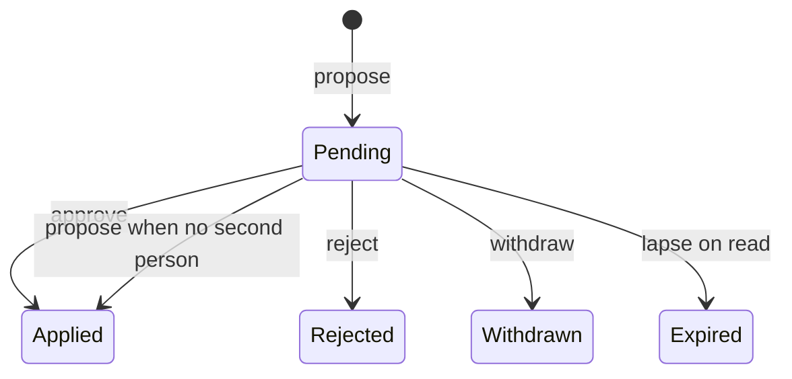

### Platform / flag differences

None inside the reducer. Whether a change needs a second person is decided by the route before `propose`.

## 2. Elevation window

- Purpose: A person asks for a time-boxed elevation, an admin approves or denies it, and the window can be ended early.
- Code: `decodeElevation` and `transitionElevation` in `src/state/elevation.ts`. `startElevation` at `admin/store.ts` applies the effect. `decideElevation` is in `admin/store.ts`. The approve route is `admin/routes.ts`.
- Persisted: yes, `gov_elevations.status`. `effectiveStatus` in `src/state/elevation.ts` is the only clock comparison. `toElevation` (`admin/store.ts`), the open-request check, the list, `decideElevation`, and the engine window all call it. The row is not updated. A second table, `elevations`, holds the window the policy engine reads.
- What changed: a start from active, denied, ended, expired, or an unknown status is refused and writes nothing. The status update requires `status = 'pending'` and exactly one changed row (`admin/store.ts`). The loser does not insert an engine row and does not bump the epoch. The approve route returns 409 for that refusal. An active row whose `until` is null, and a status word the table does not know, read as expired. The stored status and `until` stay as they were.

### States

| State | Data carried | Meaning |
|---|---|---|
| pending | principal, hours, lapsesAt | Waiting for a configure holder, or about to start |
| active | until | Window open |
| denied | decider, note | Refused |
| ended | until set to now | Closed early |
| expired | lapsesAt, a past until, or a null until | Read-time only. No privilege. Not written back |

### Events

| Event | Source |
|---|---|
| request | Admin route |
| approve / deny | Another admin |
| end | Requester or configure holder |
| lapse | Clock, on read |

### Transitions

| From | Event | Guard | To | Side effects |
|---|---|---|---|---|
| (none) | request | reason, whole hours, under role max, no open row | pending | insert |
| pending | request | `needsApproval` is false, same transaction | active | `startElevation`, bump epoch |
| pending | approve | not expired, decider is not the subject, the row is still pending | active | update `WHERE status = 'pending'`, insert `elevations` row, bump |
| active, denied, ended, expired, or unknown | start | — | unchanged | no write. Return 409 `not_startable` |
| pending | start | the pending row was already taken | unchanged | no write. Return 409 `not_startable` |
| pending | deny | not expired, not the subject, the row is still pending | denied | update `WHERE status = 'pending'`, notify |
| active | end | status is active after read-time healing, and the stored row is still active | ended | update `WHERE status = 'active'`, shorten `elevations.until`, bump |
| pending | lapse | `lapses_at <= now` | expired | none stored |
| active | lapse | `until <= now` | expired | none stored |

`startElevation` reads the stored status, including the read-time lapse, and refuses anything that is not pending. The update then requires the row to still be pending. `endElevation` on a window that is past `until` sees `expired` and returns `not_active`, so the engine row is left until its own `until`.

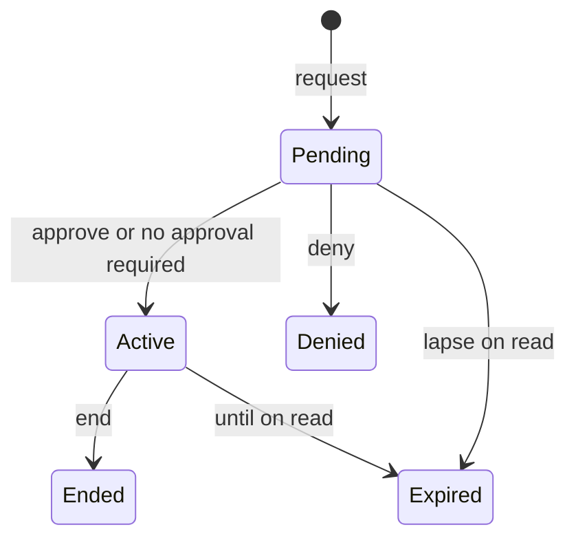

### Platform / flag differences

`needsApproval` is an input from the caller's role, decided before this store method.

## 3. Access request

- Purpose: A person asks to join a scope. A steward approves, a change fulfils it, or it is denied.
- Code: `src/state/access-request.ts`. Writers: `denyRequest` (`admin/store.ts`), `markApproved`, `reopenRequest`, `afterDecision`.
- Persisted: yes, `gov_access_requests.status` (unversioned text).
- What changed: each write names the status it may leave. `reopenRequest` requires `approved`. A decision requires `pending`. `afterDecision` requires `pending` or `approved`, and notifies only when that row changes. A lost race is 409.

### States

| State | Data carried | Meaning |
|---|---|---|
| pending | principal, scope, reason | In the queue |
| approved | decider | Steward said yes. Membership change may still be pending |
| granted | change id | The fulfilling change was applied |
| denied | decider, note | Refused, or the fulfilling change was rejected |

### Events

| Event | Source |
|---|---|
| create | Admin route |
| deny | Steward |
| mark_approved | Steward, before `propose` |
| change_applied / change_rejected | `afterDecision` (`admin/store.ts`) |
| reopen | `admin/routes.ts` and when the follow-up change cannot be made |

### Transitions

| From | Event | Guard | To | Side effects |
|---|---|---|---|---|
| (none) | create | reason, no pending or approved duplicate | pending | notify approvers |
| pending | deny | not the requester, note present | denied | notify |
| pending | mark_approved | not the requester | approved | none yet |
| approved | reopen | intended when already a member or `propose` fails | pending | clears decider and change id |
| pending or approved | change_applied | row linked by `change_id` | granted | notify |
| pending or approved | change_rejected | row linked by `change_id` | denied | notify |

`reopenRequest` (`admin/store.ts`) updates only `status = 'approved'`. `markApproved` and `denyRequest` update only `status = 'pending'`. `afterDecision` updates only `status IN ('pending', 'approved')` and skips the request notice when no row changes. A granted, denied, or still-pending request cannot be reopened. Two approvers of one pending request produce one approval.

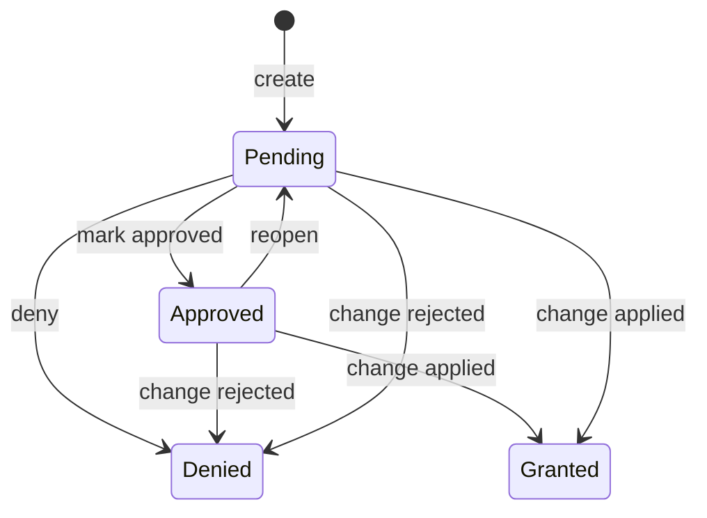

### Platform / flag differences

Restricted scopes need a second person on the membership change. That is machine 4, not a fork inside this status field.

## 4. Second-person confirmation

Review: one quorum check. #7 calls `commitQuorum` before it claims a candidate row. #8 counts distinct approvers and does not call this.

- Purpose: The first actor records an intent. A different human confirms it within 24 hours. The same human confirming does nothing.
- Code: `transitionQuorum` in `src/state/quorum.ts`. `TenantPolicy.requestSecond` performs the effects. Callers use `quorumConfirmed`.
- Persisted: yes, `pending_ops` (`key`, `requested_by`, `requested_at`). Unversioned. TTL is `SECOND_PERSON_TTL_MS` (24 hours).
- What changed: one typed result. The requester cannot confirm. A display name is not an identity. A confirm deletes only the row it read. If that delete matches nothing, the result is `replay` and the caller does not apply.

### States

| State | Data carried | Meaning |
|---|---|---|
| empty | key | Nothing waiting |
| waiting | requester identity, requestedAt | First person has asked and the row is inside the TTL |

An ask older than the TTL is an empty ask. The stored row is replaced.

### Events

| Event | Source |
|---|---|
| ask | Kill-switch re-enable, field exposure, brain open, brain role, rights export, erasure, ops restore |

### Transitions

| From | Event | Guard | To | Side effects |
|---|---|---|---|---|
| empty | ask | no row | waiting | upsert. Result `recorded` |
| waiting | ask | same actor | waiting | no write. Result `same_actor` |
| waiting | ask | different actor, `requestedAt > now - TTL`, delete matches | empty | delete that row. Result `confirmed` |
| waiting | ask | different actor, but the delete matches nothing | empty | no write. Result `replay`. Do not apply |
| waiting | ask | `requestedAt <= now - TTL` | waiting | replace the row. Result `recorded` |
| any | ask | clock is not a safe integer, or the actor id is blank | unchanged | no write. Result `refused`. Log reason code only |

`recorded`, `same_actor`, `replay`, and `refused` do not apply. Only `confirmed` does. The same actor does not refresh `requestedAt`. After a confirm, the next ask is a new `recorded`, not another confirm.

Same actor is `sameActor` in `src/state/actor.ts`. Quorum, `humanIds`, and governance `sameHuman` all call it. The same id is the same actor. When both directory subjects are set, they are the same actor only when those subjects are equal after padding is removed, so two different subjects stay two people even when an address matches. When one or both subjects are missing, they are the same actor if any normalised address matches. An address is the sign-in address or the directory email on either side. `normalEmail` and `normalizedEmailSql` fold one list: the padding set, tab, line feed, vertical tab, form feed, and carriage return. Each of those characters becomes a space, then the value is trimmed and lowercased. A blank or whitespace-only address is null on both sides. Stored emails and subjects are not rewritten.

`ensurePrincipal`, `session`, `resolvePrincipalId`, `isEmailActive` (`identity-store.ts`), `subjectOfEmail` (`identity-store.ts`), `resolveEntra` (`identity-store.ts` and ), and the rename uniqueness check (`identity-store.ts`) look up with that expression. A lookup that matches more than one stored principal is `ambiguous_principal`: the log is `{ at: "identity", reason: "ambiguous_principal", ids }` and carries no address. Nobody is picked, and no new principal is created. `isEmailActive` reports inactive and `subjectOfEmail` reports no subject. Rename refuses. When more than one row matches, the `resolveEntra` email lookup (`identity-store.ts`) refuses. The already-bound subject branch (`identity-store.ts`–) logs `ambiguous_principal`, skips the email update, and continues as the bound principal. Continuing as that principal is intended, because a bound subject is authoritative. `ensurePrincipal` inserts and reads again inside one transaction. If that read finds a different id, the insert rolls back and the result is `ambiguous`. This is M.

SCIM `user_name` is still an exact compare in `resolveEntra`, `scimUserCreate`, and `scimUserPatch`, and the list filter in `scimUserList` (`#34`). LATER, in its own commit with goldens, those compares move onto `normalizedEmailSql` under the one-identity rule. The effect is a missed match only, never a second principal. Known limit, also LATER (`#35`): SQLite `lower()` does not fold non-ASCII letters (İ, Ω), so `Ω@x.com` does not match `ω@x.com`. SQL and JS stay on one expression. A JS-only fold is not the next change.

Logs are `{ at: "illegal_transition", machine: "quorum", reason }` or `{ at: "quorum", reason: "replay" }`. The reason is a code. The line does not carry an id, a subject, or an address.

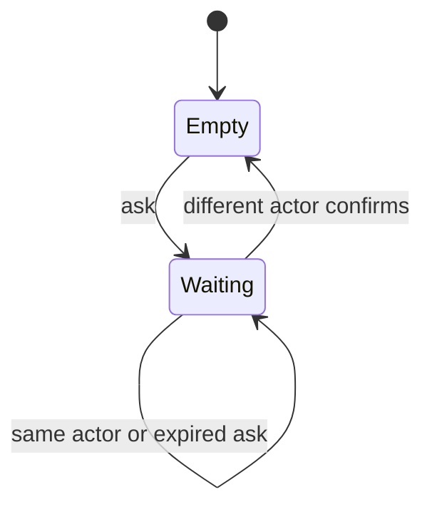

### Platform / flag differences

Callers decide whether to invoke this at all. Prod kill-switch re-enable does. Turning a switch off does not. A dev restore does not ask. #7 calls this result and then claims the candidate row. #8 does not.

## 5. Kill switch

- Purpose: `mcp`, `connector`, `ai`, and `contribute` are on unless a row says off. Turning one off is immediate. Turning one on in prod waits for a second person.
- Code: `decodeSwitchEnabled` and `transitionSwitch` in `src/state/kill-switch.ts`. `setSwitch` at `tenant-policy.ts` applies the effects. Names in `switches.ts`. Prod re-enable is `requestSecond`, the quorum machine in section 4, not a second flag state.
- Persisted: yes, `switches` plus a `pending_ops` row `switch:<name>`, and a journal entry outside the snapshot (`journal.switchSet` at `tenant-policy.ts`) so a restore cannot turn a switch back on. Replaying an off entry deletes that switch's pending ask (`security-journal.ts`). Replaying a journal `1` writes canonical on, including over a corrupt cell.
- What changed: a stored value other than `0` or `1` reads as off, and a turn-on is refused. Turning that cell off writes canonical `0` and logs `corrupt_value` without the stored value. An unknown name, a non-boolean, and a clock that is not a safe integer do not write. A pending ask whose name is not one of the four switches is omitted from `switchStatus`. Quorum `replay` and `refused` are their own results. An unknown name already stored in `switches` is still skipped at `tenant-policy.ts` (`#36`).

### States

| State | Data carried | Meaning |
|---|---|---|
| on | absent row, or `enabled` 1 | Enabled. Absence means on |
| off | `enabled` 0 | Disabled |
| corrupt | any other `enabled` value | Unreadable. Reads as off. Turn-on is refused |

The pending ask is a quorum row in `pending_ops`. It is not a flag state.

### Events

| Event | Source |
|---|---|
| turn_off | Ops route, any one person |
| turn_on | Ops route. `twoPerson` false, or a quorum result |

### Transitions

| From | Event | Guard | To | Side effects |
|---|---|---|---|---|
| on, off, or corrupt | turn_off | clock is a safe integer | off | write `enabled` 0, delete pending, journal. A corrupt cell also logs `corrupt_value` |
| on | turn_on | already on, including when `twoPerson` is set | on | no write, and no new ask. Return `applied` |
| off | turn_on | `twoPerson` is false | on | write `enabled` 1, journal. A stale pending row stays |
| off | turn_on | `twoPerson`, quorum result is `recorded` or `same_actor` | off | no write. Return `pending`. `sameActor` when the quorum tag is `same_actor` |
| off | turn_on | `twoPerson`, quorum result is `replay` | off | no write. Return `replay` |
| off | turn_on | `twoPerson`, quorum result is `refused` | off | no write. Return `refused` |
| off | turn_on | `twoPerson`, quorum result is `confirmed` | on | write `enabled` 1, journal. Quorum already deleted the ask |
| corrupt | turn_on | — | corrupt | no write. Return `refused`. Log `corrupt_value` |
| any | turn_off or turn_on | clock is not a safe integer | unchanged | no write. Return `refused`. Log `clock_unreadable` |
| — | unknown name, or a non-boolean | boundary, before the transition | unchanged | no write. Return `refused`. Log `unknown_name` or `enabled_unreadable`. The line has no name and no value |

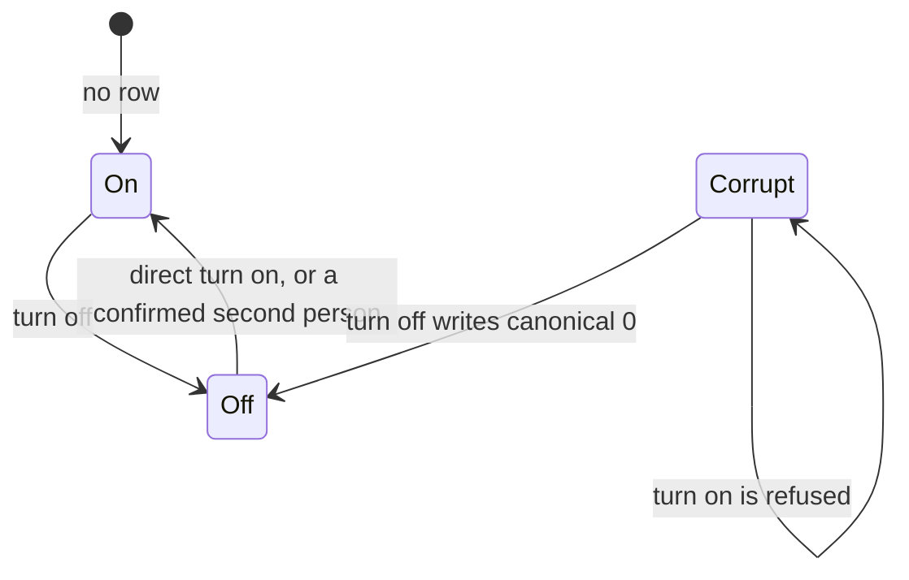

### Platform / flag differences

`twoPerson` is an argument. The ops route sets it from prod. The route returns 409 `switch_refused` for `refused` and for `replay` (`ops-admin.ts`). `202` with `needs: second_person` is only for a pending ask (`recorded` or `same_actor`).

## 6. OIDC login

- Purpose: A browser starts Entra login, the callback is accepted once, and a session cookie replaces any session that browser already held.
- Code: `transitionLoginRecord` in `src/state/login-record.ts`. The route is `auth/routes.ts` `GET /callback`. `GET /login` and `POST /logout` stay as they were.
- Persisted: yes, a login record (`loginStatePut` / `loginStateTake`) and a session row (`sessionCreate` / `sessionDelete`). Unversioned. The row is the issued record. Taking it is the consume effect.
- What changed: an IdP error, a missing state, a mismatched state, a failed code exchange, and a successful callback all consume the login row. A consumed row cannot be used again. The log line is `{ at: "entra_login", reason }` and the reason is a fixed code.

### States

| State | Data carried | Meaning |
|---|---|---|
| anonymous | — | No session |
| issued | state hash, nonce, verifier, returnTo | Cookie plus stored record |
| consumed | — | The row has been taken. A replay is refused |
| session_open | session hash, tenant | Signed in |

### Events

| Event | Source |
|---|---|
| start | `GET /login` |
| idp_error | `GET /callback` with an IdP `error` |
| missing_state | `GET /callback` missing the cookie, the state, or the code |
| state_mismatch | `GET /callback` whose state does not match the cookie |
| exchange_failed | code exchange or token verification failed |
| accepted | `GET /callback` whose cookie, state, and code match |
| logout | `POST /logout` |

### Transitions

| From | Event | Guard | To | Side effects |
|---|---|---|---|---|
| anonymous | start | Entra configured, under IP limit, discovery works | issued | store record, set cookie, redirect |
| issued | idp_error, missing_state, state_mismatch, exchange_failed, or accepted | the record has not been taken | consumed | `loginStateTake` on the cookie hash and, when it differs, the query hash |
| consumed | any of those events | already taken | consumed | refuse. No second take |
| consumed | accepted, and the token, guest, and tenant checks pass | row was taken for this callback | session_open | create session, delete the previous session cookie's row |
| session_open | logout | same origin | anonymous | delete session, clear cookie |

The cookie is cleared before the take. The take still runs, because the handler already read the cookie value. A replay presents that value again and finds no row.

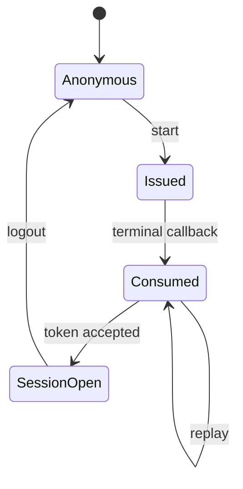

### Platform / flag differences

`entraEnabled`, `allowGuests`, and `scimConfigured` are guards on start and callback. They are read from env inside the handlers, not passed as named guard inputs.

## 7. Workspace item release

Review: shares the quorum check with #4. #8 counts distinct approvers and does not use this result.

- Purpose: A contributed item waits as a candidate until enough distinct people approve it. An edit of an approved item sends it back to review.
- Code: `transitionItem` in `src/state/item-release.ts`. `Workspace.update` and `Workspace.approve` perform it. `approve` calls `commitQuorum` and releases only on that result.
- Persisted: yes, `items.status`. There is no version tag on the status value.
- What changed: `update` no longer stores an arbitrary status. `approved` is only the release transition. A record status in the allow-list still updates.

### States

| State | Data carried | Meaning |
|---|---|---|
| draft | revision | Not in the release queue |
| candidate | revision, approvals | Waiting |
| approved | revision | Released |
| rejected | — | Used by the wiki path (machine 8), not by `Workspace.approve` |
| other | any string already stored | `update` cannot write it |

### Events

| Event | Source |
|---|---|
| create / update | API, status taken from the caller |
| edit | Contribute path |
| review | Records a verdict only |
| approve | Release path |

### Transitions

| From | Event | Guard | To | Side effects |
|---|---|---|---|---|
| (none) | create | id is new | caller status | insert |
| any | update | status omitted, unchanged, or in the allow-list | that status | new revision, clears `reviewed_by_2` |
| any | update | status outside the allow-list, including `approved` | unchanged | no write. Result `invalid_status`. Log `status_rejected` |
| approved | edit | revision matches | candidate | new revision |
| draft or candidate | edit | revision matches | same status | new revision |
| candidate | review | not an author | candidate | upsert a review row. Status unchanged |
| candidate | approve | not an author, this human has not approved this revision, approvals reach `required`, and the candidate row is still candidate | approved | one conditional update. Outbox `item.released` only when that update matches |
| candidate | approve | the release update matches nothing | candidate | approval row stays. Result `replay`. No `item.released` |
| candidate | approve | approvals still short | candidate | approval row only |

`required` is 2 for a global release or `GLOBAL_NONPERSONAL`, otherwise 1. A scope release is a recorded quorum ask. A global release waits for `confirmed`. The approval row and `claimRelease` are one transaction. A throw between them rolls the approval back. `claimRelease` accepts the status write only when it matches one candidate row. `STATUSES` still has no approval word, so the record route cannot send one. The record words it does send are in the allow-list.

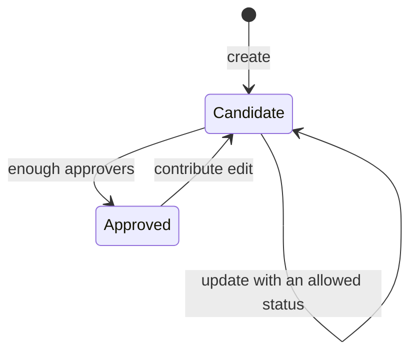

### Platform / flag differences

Global versus scope changes `required`. It is data on the item (`releaseTarget`, `plane`), not a hidden branch in a second status field.

## 8. Wiki proposal review

Review: includes machine 10. Approval counts distinct person ids. It does not use the 24-hour quorum. Fixed.

- Purpose: A wiki proposal is a workspace item of kind `wiki_ingest`, `wiki_lint`, or `wiki_dream`. Deciding it applies or discards a diff.
- Code: `src/state/proposal-review.ts`. `decodeProposalStatus` reads `candidate`, `approved`, and `rejected`. Any other word is unknown. `distinctApprovers` counts person ids. `transitionProposal` commits through `commitProposal`. `wikiDecide` is `wiki/store.ts`. Reject compares `status = 'candidate'`. The approve call passes those ids. The short approval in `wikiDecide` returns pending. The completing approval compares `status = 'candidate'`. `wikiEditProposal` compares `status = 'candidate' AND revision = ?`. The archive loop in `applyProposal` compares `status = 'published'`. The erase scrub in `wikiForgetSources` compares the prior status. The cited source is `citedSourceIds` (`src/state/proposal-citation.ts`), applied in `wikiForgetSources`.
- Persisted: yes, the same `items.status` column as machine 7. Response field `status: "pending"` is not the stored status. The short approval insert and its log share one transaction. The row stays `candidate` until the last approval.
- What changed: a decision that loses the candidate row writes nothing. An unknown stored word writes nothing. A finding effect writes only from `open`. A second approver releases a two-person proposal whether they arrive inside a day or after it. The dev seed approval write stays outside this machine.

### States

| State | Data carried | Meaning |
|---|---|---|
| candidate | revision, body, approvals | Open |
| approved | — | Diff applied, or auto-accepted |
| rejected | — | Discarded, or scrubbed because a source was erased |
| pending | approvals, required | Response only, while stored status is still candidate |

### Events

| Event | Source |
|---|---|
| propose | Import, push, routines, engine |
| approve / reject | `wikiDecide` |
| edit | `wikiEditProposal` |
| erase_source | Retention scrub |
| auto_accept | explicit `publishDirect`, or dev seed. A personal `autoAccept` stays a draft (#11) |

### Transitions

| From | Event | Guard | To | Side effects |
|---|---|---|---|---|
| (none) | propose | payload parses | candidate | optional finding row `open` |
| candidate | auto_accept | dev seed, or ingest and explicit `publishDirect` from a candidate | approved | `applyProposal` writes pages |
| candidate | reject | not an author (personal brain skips that check) | rejected | finding `dismissed` if any |
| candidate | approve | revision hash matches, pages not stale, this human has not approved, count still short | candidate | response `pending` |
| candidate | approve | count reaches `required` (1 in a personal brain, else the item's required) | approved | `applyProposal`, finding `resolved` |
| candidate | edit | page exists, not generated, markdown non-empty | candidate | revision + 1, prior approvals no longer match |
| candidate | erase_source | proposal cites the erased source | rejected | body replaced with an empty proposal |
| approved or rejected | erase_source | same | stored status unchanged | body still scrubbed ( `CASE`) |
| any other word | erase_source | same | rejected | body emptied in that statement, including `legacy` and unknown |

Authors cannot decide a non-personal proposal. A second approval by the same human returns `already_done` and adds nothing to the count. `wikiDecide` releases when the number of distinct approver ids reaches `required`. Personal scope forces that number to 1. The 24-hour quorum is not consulted.

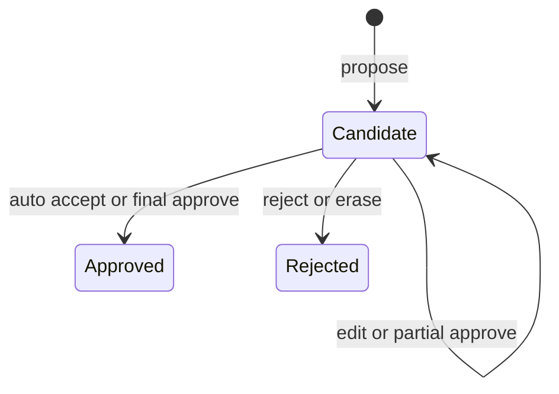

### Platform / flag differences

`ENVIRONMENT === "dev"` plus `opts.seed` auto-approves seed origin. That write is not this machine. Personal scope forces `required = 1`. That number is the `required` input of `transitionProposal`.

## 9. Wiki page visibility

Review: the fix is a status predicate plus an unarchive event, not a larger lifecycle. Fixed.

- Purpose: A page is readable while `published`. Archiving hides it. Saving does not unarchive.
- Code: `src/state/page-visibility.ts`. `decodePageStatus` reads `published` and `archived`. Any other word is unknown. `savePage` (`wiki/store.ts`) commits a save and updates `WHERE status = 'published'`. `unarchivePage` commits an unarchive and updates `WHERE status = 'archived'`. The archive loop commits an archive and updates `WHERE status = 'published'`. `wikiDecide` returns the refusal instead of approving. Callers of `savePage`: proposal pages, generated pages, the overview, and a promotion.
- Persisted: yes, `wiki_pages.status`. The type says `"published" | "archived"` (`wiki/types.ts`). The column is unversioned text. A stored word outside those two is unknown and is not written.
- What changed: an archived save no longer sets `published`. The revision and the search row are written only when the compare-and-set changes one row. A refused save is not a successful decision.

### States

| State | Data carried | Meaning |
|---|---|---|
| absent | — | No row |
| published | revision, markdown | In search and default lists |
| archived | revision | Hidden from search. Still loadable when archive is included |
| unknown | the stored word | Not readable. No effect |

### Events

| Event | Source |
|---|---|
| save | `savePage`, from `applyProposal`, generated pages, and promotion |
| archive | Proposal `archive` ids |
| unarchive | `unarchivePage`. No route calls it yet |

### Transitions

| From | Event | Guard | To | Side effects |
|---|---|---|---|---|
| absent | save | — | published | insert revision 1 |
| published | save | title or markdown changed, `WHERE status = 'published'` | published | revision + 1 |
| published | save | title and markdown unchanged | published | no write |
| archived | save | — | archived | refused, reason `archived` |
| unknown | save, archive, or unarchive | — | unknown | refused, reason `state_unreadable` |
| published | archive | `WHERE status = 'published'` | archived | drop the search row |
| archived or absent | archive | — | same | no write |
| archived | unarchive | `WHERE status = 'archived'` | published | restore the search row |
| published | unarchive | — | published | refused, reason `not_archived` |
| absent | unarchive | — | absent | refused, reason `absent` |

Zero changed rows is `replay`. The page is left as the winner wrote it, and no revision is added. An archive that lands after the save has read the page, and before the save writes, keeps the page archived.

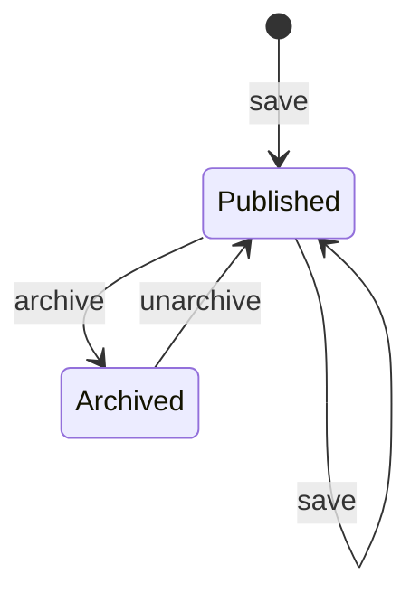

### Platform / flag differences

None.

## 10. Wiki finding

Folded into #8. These states are effects of proposal review. There is no separate reducer. Fixed with #8.

- Purpose: A lint or ingest finding tracks whether the proposal that would fix it is still open.
- Code: `transitionFinding` (`src/state/proposal-review.ts`). Insert in `wikiPropose`. Dismiss and resolve in `wikiDecide`. Both updates match `status = 'open'`.
- Persisted: yes, `wiki_findings.status`. Unversioned. A stored word other than `open`, `dismissed`, or `resolved` is unknown.
- What changed: a dismissed or unknown finding is not overwritten when a proposal is approved or rejected.

### States

| State | Data carried | Meaning |
|---|---|---|
| open | key, kind, proposal id | Created with the proposal |
| dismissed | — | Proposal rejected |
| resolved | — | Proposal approved and applied |

### Events

| Event | Source |
|---|---|
| open | `wikiPropose` when `findingKey` is set (`INSERT OR IGNORE`) |
| dismiss | reject branch |
| resolve | final approve branch |

### Transitions

| From | Event | Guard | To | Side effects |
|---|---|---|---|---|
| (none) | open | — | open | insert |
| open | open | same key | open | ignored |
| open | dismiss | reject path | dismissed | `WHERE status = 'open'` |
| open | resolve | approve path | resolved | `WHERE status = 'open'` |

A dismissed, resolved, or unknown finding has no effect, so a later approval does not overwrite it.

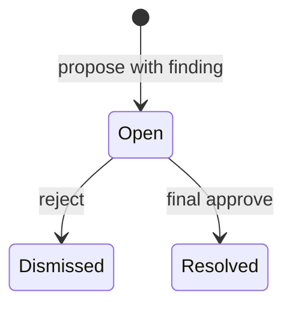

### Platform / flag differences

None.

## 11. Brain import outcome

Review: Jarvis decided that a personal-brain auto-accept import stays a draft, matching the dry run. The dry run and the real import share one `publishMode()` that defaults to draft. Publishing is an explicit action. Fixed.

- Purpose: Each file in an OKF, Obsidian, or Outline import is skipped, shown as a dry-run draft, or written as a draft proposal. Publishing that proposal is a separate explicit action.
- Code: `src/state/import-outcome.ts`. `decodeImportStatus` reads `candidate` as draft and `approved` as published. Any other word is unknown. `publishMode` returns draft unless the caller passes true. `transitionImport` commits through `commitImport`. `runImport` is `brains/data.ts`. `ImportOut` is the result of `runImport`. The draft markdown is built there. Parsers in `brains/importers.ts` only build documents. They do not publish.
- Persisted: the proposal item status is `candidate` until an explicit publish. The import response itself is not stored. Both response states are `publishMode(false)` (`brains/data.ts`, dry , real ).
- What changed: the personal `autoAccept` branch no longer publishes. An explicit publish compares the previous status.

### States

| State | Data carried | Meaning |
|---|---|---|
| draft | stored `candidate` | Open proposal. An import reports this |
| published | stored `approved` | An explicit publish applied the diff |
| unknown | anything else | Writes nothing |

### Events

| Event | Source |
|---|---|
| auto_accept | Personal `autoAccept`, and every import |
| publish | Explicit `publishDirect` |

### Transitions

| From | Event | Guard | To | Side effects |
|---|---|---|---|---|
| draft | auto_accept | — | draft | none |
| published | auto_accept | — | published | none |
| draft | publish | one row still `candidate` | published | `applyProposal` writes pages |
| published | publish | — | published | refused `not_draft`, no write |
| unknown | auto_accept or publish | — | unknown | refused `state_unreadable`, no write |

`wikiPropose` (`wiki/store.ts`) takes the publish event only when `publishDirect` is true. The compare-and-set is `UPDATE items SET status = 'approved' ... WHERE id = ? AND status = 'candidate' RETURNING id`. Zero rows is `replay` and does not apply the diff. A personal auto-accept is the `auto_accept` event and returns `autoAccepted: false`. The dev seed is unchanged. The citation loop is `cleanDraft`.

Ordering that is easy to miss: a real import audits once before the per-page loop. A dry run returns before that audit. A failed audit returns 503 and writes nothing.

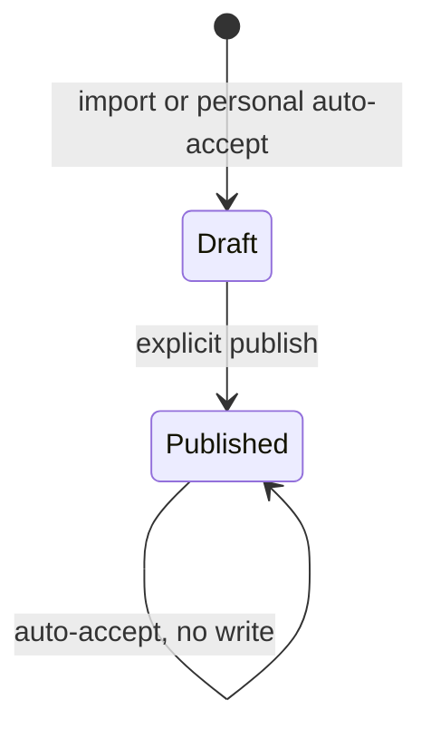

### Platform / flag differences

The `imports` flag is checked before the handler body (`needFlag`). It does not choose the state. Session-report `publishDirect` (`brains/push.ts`) is still the explicit publish action and is machine 28.

## 12. Brain member

- Purpose: A person has a stored brain role that is either already in force or waiting on a directory change.
- Code: `src/state/brain-member.ts`. `brainMemberClaim` (`brains/store.ts`) mints the key and stores it before `gov.propose`. `brainMemberRelease` and `brainMemberDropClaim` compare that key and the previous state. `brainMemberFinishProposal` does the same. `reconcileBrainMember` looks the key up. `placeScopedMember` runs the claim first. `reconcileStoredMembers` (`brains/open.ts`) reconciles, then the read continues. The route returns the refusal at `brains/routes.ts`.
- Persisted: yes, `brain_members.state` (`claimed`, `active`, or `pending`), `claim_key`, and `change_id`. `gov_changes.claim_key` is nullable. Unversioned. Remove deletes the row. A legacy governance row keeps a null key.
- What changed: the claim stores an opaque key before propose, and `propose` (`admin/store.ts`) returns the existing change for that key. The column is added at `admin/store.ts` with a unique index. Existing rows are not rewritten. The two stores still do not share a transaction, and governance does not write `brain_members`. A thrown proposal leaves the keyed claim. The next attempt reuses the key. A refused claim does not propose, and a refused proposal releases that key. Zero rows is `state_unreadable`. A drop never deletes by person. A finish that loses the compare-and-set is `mismatch` and logs the principal id, the change id, and the stored state. Overlapping finishes log once. The next read looks the key up. Applied finishes the claim. Pending, or no governance row yet, leaves it and writes no log. Rejected, expired, or withdrawn releases it. `grantsMemberRole` (`src/state/brain-member.ts`) is the only grant check. `brainRoleOf` (`brains/store.ts`), the access-list role (`brains/routes.ts`), the extra stored rows, the member check, and the reader count (`brains/shared.ts`) call it. The access list reconciles at `brains/routes.ts`. The reader count reconciles at `brains/shared.ts`. A claimed or pending row grants nothing.

### Accepted limits

| | Limit | Where | Decision |
|---|---|---|---|
| i | List reconcile is bounded to 20 ids. A later claim grants nothing and converges on a direct per-person read. | `reconcileStoredMembers` (`brains/open.ts`), `ids.slice(0, 20)` at | Accepted |
| ii | Reconcile ignores a zero-row drop or finish. The row stays and the next read retries. | `reconcileBrainMember` (`brains/store.ts`) | Accepted, fail-safe |
| iii | An unknown governance status stays claimed and grants nothing. | `reconcileBrainMember` (`brains/store.ts`), after `changeByKey` | Accepted |
| iv | `brainMemberRemove` still deletes by person. It is only called after an applied removal. Make it a compare-and-set on the active state once the removal machine is done. | delete at `brains/store.ts`, method , caller `brains/routes.ts` | LATER |

### States

| State | Data carried | Meaning |
|---|---|---|
| absent | — | No row |
| pending | role, actor | Directory change not applied yet |
| active | role, actor | In force |

### Events

| Event | Source |
|---|---|
| set | Member route |
| remove | Member route when role is null and the directory change applied |

### Transitions

| From | Event | Guard | To | Side effects |
|---|---|---|---|---|
| absent or any | set | caller passes `active` | active | upsert, wiki log |
| absent or any | set | caller passes `pending` | pending | upsert, wiki log |
| active or pending | remove | directory removal already applied | absent | delete |

`brainMemberClaim` inserts with `ON CONFLICT DO NOTHING` (`brains/store.ts`) and updates with `WHERE principal_id = ? AND state = ? AND at = ?`. The key is stored on that write. `brainMemberFinish` writes an unscoped role and logs only when that claim still matches. Zero rows is `replay`. `brainMemberFinishProposal` matches `claim_key` and the previous state. Zero rows is `mismatch` unless the row is already finished: the log is the principal id, the change id, and the stored state, and the route returns 409 with that code. A stored word other than `pending` or `active` is `state_unreadable` and is not rewritten. `placeScopedMember` returns 409 before `gov.propose` in that case. The route surfaces it at `brains/routes.ts`. `brainMemberRelease` and `brainMemberDropClaim` are `state_unreadable` when zero rows match. `reconcileBrainMember` is the next read. It does not share a transaction with governance. Governance stays the source of truth. Pending or a missing row leaves the claim. Rejected, expired, or withdrawn releases it. Applied finishes it.

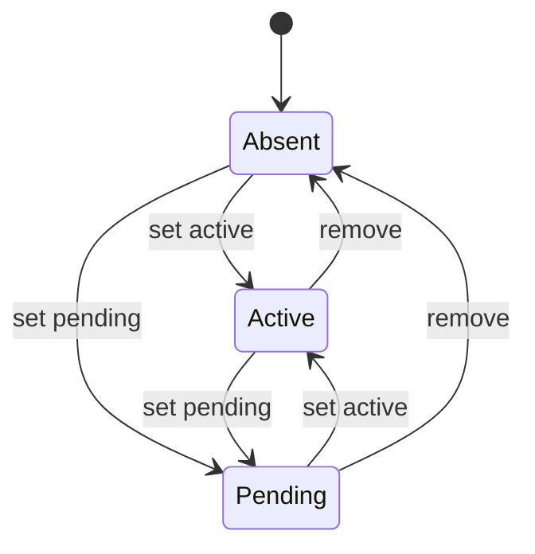

### Platform / flag differences

Restricted brains and heavy roles on a global brain set `needsSecond` before this write (`brains/routes.ts`). That uses machine 4.

## 13. Replay nonce

- Purpose: A signed internal call's nonce is accepted once. Seeing it again is refused for the caller's replay window and after that window, because expiry does not delete the row.
- Code: a named guard, `nonceFirst` at `tenant-policy.ts`. It is not a reducer. Tests call that method on real SQLite in `harness/tests/nonce-first.test.ts` and `harness/tests/nonce-retention.test.ts`. The in-memory double in `harness/tests/contracts-security.test.ts` still only copies accept-once for the HMAC tests.
- Persisted: yes, `nonces` (`key` primary key, `expires_at`). Unversioned. `expires_at` records the window. It is not a reason to forget the key.
- What changed: the `DELETE` of rows with `expires_at <= now` is not part of accepting a key. `INSERT OR IGNORE ... RETURNING key` is the whole guard. One row returned means accept. No row means the key was already stored, including when the stored window has passed. `verifyInternalRequest` and `verifyOpsRequest` reject a timestamp outside the shared clock skew before `nonceFirst` runs. On insert, `expires_at` is derived from the token time and that window, not from the receive time. An unsafe bound is refused and not stored. `pruneNonces` deletes only rows with `expires_at < now`, and it is not called from `nonceFirst`.

### States

| State | Data carried | Meaning |
|---|---|---|
| unseen | — | No row for this key |
| seen | expiresAt | Accepted once. Later presents are refused |

### Events

| Event | Source |
|---|---|
| present | `verify` of an internal request |

### Transitions

| From | Event | Guard | To | Side effects |
|---|---|---|---|---|
| unseen | present | `INSERT OR IGNORE` returns a row | seen | caller accepts the request |
| seen | present | insert ignored, including when `expires_at <= now` | seen | caller rejects |

The guard has no expire transition back to unseen. Both verifiers share `MAX_SKEW_SECONDS` and `CLOCK_GRANULARITY_MS` (`signed-call.ts`). They accept timestamp `T` while the floored unix second `now_s` satisfies `|now_s - T| <= MAX_SKEW_SECONDS`, so the last accepted instant is `(T + MAX_SKEW_SECONDS) * CLOCK_GRANULARITY_MS + (CLOCK_GRANULARITY_MS - 1)`. `expires_at` is `(T + MAX_SKEW_SECONDS + 1) * CLOCK_GRANULARITY_MS`, which is strictly greater than that instant, and it does not depend on when the request arrived. `pruneNonces` deletes a row only when `expires_at < now`, which is already after every instant either verifier will accept `T`. A replay then fails the timestamp check and does not reach `nonceFirst`. It is High because it is the replay gate for connector, MCP, and ops calls. The fix stays this guard. It does not add a reducer.

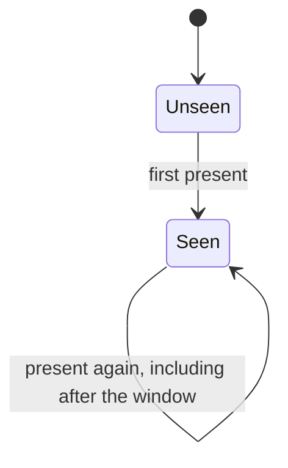

### Platform / flag differences

With a bound, the stored expiry is `nonceExpiresAt` (the token time plus the shared clock window). The `ttlMs` argument does not set it. Without a bound, `ttlMs` is still the stored lifetime.

## 14. Model-call retry

- Purpose: One non-streaming Messages call retries bounded HTTP failures and stops on a terminal body.
- Code: `src/state/model-call.ts` (`transitionModelCall`). Tests: `harness/tests/model-call-machine.test.ts`. `callModel` fetches and sleeps from the effect list.
- Persisted: no. There is no codec. A reply's text stays in the call result and is not written.
- What changed: the retry decision moved into the reducer. `callModel` still returns the same reply for the same responses. A 2xx status sent as an HTTP failure is rejected and logged. The caller classifies a 2xx body instead, which is what the old loop did. Sleep stays `250 * 2 ** (attempt - 1)` before the next fetch. NaN, Infinity, and a negative retry count fail closed instead of looping.

### States

| State | Data carried | Meaning |
|---|---|---|
| calling | attempt index, retries allowed, last failure code | About to send, or about to send again |
| done | reply | Returned to the caller |

The loop is `for (attempt = 0; attempt <= retries; attempt++)`. Sleep before attempt `n > 0` is `250 * 2 ** (n - 1)` milliseconds. A negative or non-numeric `retries` does not enter the loop and returns `upstream_error`.

### Events

| Event | Source |
|---|---|
| http status | `fetch` response |
| timeout | `AbortError` |
| transport | any other throw |
| refused / truncated / empty / success | parsed body, only after a non-retryable 2xx |

### Transitions

| From | Event | Guard | To | Side effects |
|---|---|---|---|---|
| calling | retryable status (408, 409, 429, 500, 502, 503, 504, 529) | `attempt < retries` is the wrong test for a non-integer; the loop retries while `attempt + 1 <= retries` | calling, last = `upstream_error` | sleep, then another fetch |
| calling | retryable status | no attempt left | done `upstream_error` | return |
| calling | other HTTP error | none | done `upstream_error` | return immediately, attempts left unused |
| calling | timeout or transport | another attempt fits | calling, last = `timeout` or `upstream_error` | sleep, retry |
| calling | timeout or transport | no attempt left | done with that code | return |
| calling | refusal, truncation, empty, success | body was ok | done | return immediately |

A retryable status never becomes `timeout`. A fatal HTTP status does not retry. That split is two `if`s, not a table. Terminal `done` plus another event is not representable because the function has already returned.

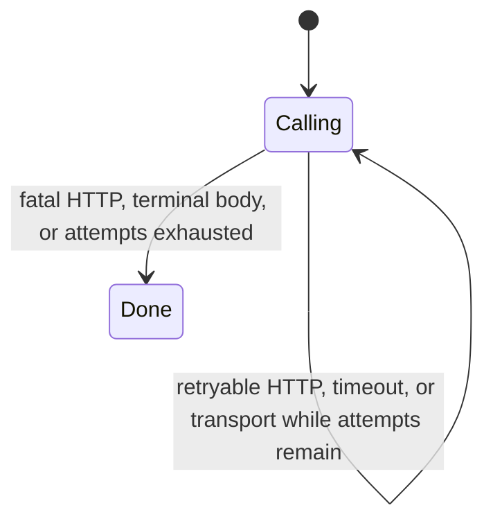

### Platform / flag differences

None. `retries` and `timeoutMs` come from the request.

## 15. Stream-open retry

- Purpose: One streaming round may retry a retryable HTTP status once, and only before any event byte is parsed.
- Code: `src/state/stream-open.ts` (`transitionStreamOpen`). Tests: `harness/tests/stream-open-machine.test.ts`. `streamRound` fetches, cancels, and sleeps from the effect list.
- Persisted: no. There is no codec. The open attempt lives only for this request.
- What changed: the open/retry decision moved into the reducer. A retryable status still retries once, with the same 250ms delay, and only from the first attempt. Each attempt arms its own abort timer, and that timer is cleared before the retry sleep, so the wait does not consume the next attempt's timeout. A timeout or a throw still fails the round with no second try, including after the body is being read. An HTTP event after the body was accepted is rejected and logged.

### States

| State | Data carried | Meaning |
|---|---|---|
| opening | attempt 0 or 1 | Request in flight, body not parsed |
| streaming | response body | Retry is no longer allowed |
| failed | `upstream_error` or `timeout` | Round failed before a successful parse |

### Events

| Event | Source |
|---|---|
| http status | Response headers |
| timeout / transport | Outer catch, which also covers the read loop |

### Transitions

| From | Event | Guard | To | Side effects |
|---|---|---|---|---|
| opening attempt 0 | retryable status | attempt is 0 | opening attempt 1 | cancel body, sleep 250ms |
| opening attempt 1 | retryable status | — | failed `upstream_error` | do not read |
| opening | non-ok, non-retryable | — | failed `upstream_error` | cancel body |
| opening | ok with a body | — | streaming | parse SSE (machine 20) |
| opening | ok without a body | — | failed `upstream_error` | — |
| opening or streaming | timeout | — | failed `timeout` | no second try |
| opening or streaming | other throw | — | failed `upstream_error` | no second try |

The file comment matches the code: the retry decision happens before `getReader`, and the abort timer is per attempt. A 200 that later breaks is not retried. Timeout does not use the attempt loop. That difference from machine 14 is implicit.

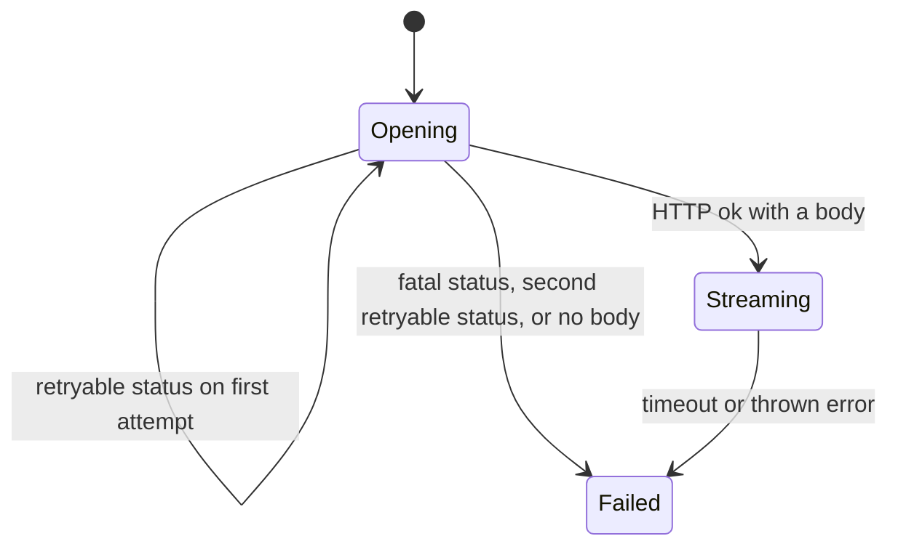

### Platform / flag differences

None.

## 16. Token-budget hold

- Purpose: Reserve an estimate before a model call and settle to the real token count after it.
- Code: `src/state/budget-hold.ts` (`transitionBudgetHold`). Tests: `harness/tests/budget-hold-machine.test.ts`. `reserve` applies the `adjust` effect.
- Persisted: the day counter is a workspace row (`ai:usage`). The hold is request-local and has no codec. `reserve` does not write it.
- What changed: `settle` is once only. A second call is logged and does not add the diff again. A non-finite estimate is rejected before `store.add`. If the settle diff itself fails to write, that failure is logged with no amounts and the hold stays settled. `withUserCap` logs a refund that returns null, still with no amounts. Making that refund idempotent is later. If the refund does not land, the user counter stays high.

### States

| State | Data carried | Meaning |
|---|---|---|
| idle | — | Nothing reserved |
| held | estimate | `store.add(estimate)` succeeded |
| denied | — | Cap would be exceeded. `reserve` returns null |
| settled | actual | Difference applied once |

### Events

| Event | Source |
|---|---|
| reserved / denied | Result of `store.add` |
| settle | Caller after the model returns (`agent/loop.ts`, and the other `reserve` callers) |

### Transitions

| From | Event | Guard | To | Side effects |
|---|---|---|---|---|
| idle | reserved | add returned a total | held | estimate already added |
| idle | denied | add returned null | denied | `reserve` returns null |
| held | settle | finite actual | settled | `add(Math.round(actual) - estimate)` when the diff is non-zero, cap `MAX_SAFE_INTEGER` so the settle is not refused |
| settled | settle | — | rejected | `openHold` returns before `store.add`, so the diff is not applied again |

The refund path in `withUserCap` is separate: if the user add succeeds and the tenant add returns null, it tries `user.add(-tokens)`. If that refund add also returns null, the user counter stays high and the tenant counter does not move. That gap is not fixed with this machine. It is called out so a later review does not treat the hold fix as covering it.

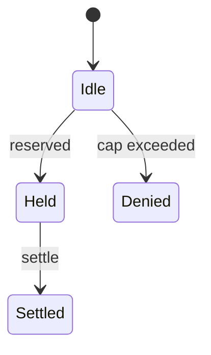

### Platform / flag differences

None. The cap is an argument.

## 17. Token-counter CAS retry

- Purpose: Add tokens to the day row using the row revision as a compare-and-set, and retry when another request wrote first.
- Code: `src/state/budget-cas.ts` (`transitionBudgetCas`). Tests: `harness/tests/budget-cas-machine.test.ts`. `doBudget` reads and writes the row, then applies the step.
- Persisted: the counter body is the total. `decodeUsageBody` reads it: empty is 0, a canonical non-negative integer is that total, and anything else (corrupt, negative, NaN) is the cap already reached. The log names the row key and not the cell. The attempt is request-local and has no codec. `doBudget` does not write the attempt.
- What changed: continue versus stop moved into the reducer. Six attempts and an immediate cap refusal are unchanged. A `wrote` or `over_cap` event after the attempt has finished is rejected and logged.

### States

| State | Data carried | Meaning |
|---|---|---|
| trying | attempt 0..5 | Read or write in progress |
| committed | new total | `edit` returned ok |
| refused | — | Positive add would pass the cap, or six attempts failed |

### Events

| Event | Source |
|---|---|
| over_cap | positive add would exceed `cap`, or the stored body is unreadable |
| wrote | `edit` ok. Carries the new total |
| retry | `doBudget` maps a missing row (get or create yielded nothing) and a failed edit onto this event |

### Transitions

| From | Event | Guard | To | Side effects |
|---|---|---|---|---|
| trying | over_cap | — | refused | return null immediately, remaining attempts unused. The row is not edited |
| trying | wrote | — | committed | return the new total |
| trying | retry | `attempt + 1 < 6` | trying | loop |
| trying | retry | attempt is 5 | refused | return null |

The cap check is not retried. A missing row and a failed edit are. `doBudget` is what turns those two outcomes into `retry`.

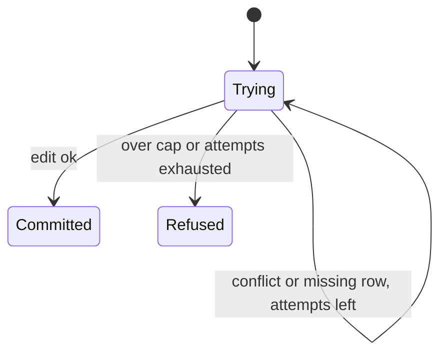

### Platform / flag differences

None.

## 18. Wiki seed claim

- Purpose: In dev, one request runs the synthetic wiki seed for a version. Others see current, busy, off, or unseeded.
- Code: `src/state/wiki-seed.ts` (`transitionWikiSeed`, `seedRunStatus`). Tests: `harness/tests/wiki-seed-machine.test.ts`. `seedClaim`, `seedDone`, and directory `seed` write only the cells the reducer returns. `ensureWikiSeed` returns `seedRunStatus`.
- Persisted: yes, `config.seed_version` and `config.seed_claim`. Logical record is version 1. A missing version is completed 0. A non-numeric version, or a claim that is not `{ version, at, owner }`, loads as unreadable. Unreadable rejects claim and complete. `reset` clears it. Unknown blob version loads as unreadable, not as a fresh tenant.
- What changed: a claim carries an owner token, and `complete` must present that same token. After the lease, a new claim replaces the old one, and the previous owner's completion cannot clear it. `complete` with no claim is rejected. `seedVersion` on a corrupt cell returns `reseed needed` and logs the key, not the cell. `applySeed` writes only when the effect list says `write`. Rejection `from` is `idle`, `claimed`, or `unreadable` for the record in hand. `wiki/seed-content.ts` was not edited.

### States

| State | Data carried | Meaning |
|---|---|---|
| idle | completed version (0 if absent) | No claim |
| claimed | completed version, claim version, claimedAt | A run holds the lease (default 120000 ms) |
| off / unseeded / current / busy / seeded | run counters on `seeded` | The value `ensureWikiSeed` returns. `busy` is also the catch path (70–73), which leaves the claim in place |

### Events

| Event | Source |
|---|---|
| claim | `ensureWikiSeed` after the env and config checks |
| complete | `seedDone` after every workspace returns |
| reset | `TenantPolicy.seed` directory reseed |
| fail | Exception inside the seed loop |

### Transitions

| From | Event | Guard | To | Side effects |
|---|---|---|---|---|
| idle or claimed | claim | `completed >= version` | unchanged | rejected and logged. Run result `current` |
| claimed | claim | any unexpired claim (`now - at < lease`) | unchanged | rejected and logged. Run result `busy` |
| idle or expired claim | claim | `completed < version` | claimed | write the claim |
| claimed | complete | owner matches, claim version matches, and the version is not below `completed` | idle at that version | write the version, delete the claim |
| idle | complete | no claim | unchanged | rejected and logged |
| claimed | complete | owner differs, claim version differs, or the new version is lower | unchanged | rejected and logged. The live claim stays |
| any | reset | dev directory seed | idle, completed 0 | delete both keys |
| claimed | fail | exception in `ensureWikiSeed` | claimed | return `busy`. The claim stays until the lease |

`seed` (213) is dev-only and wipes the directory. The wiki keys are cleared in that transaction so the next request seeds again. That reset is a real transition and it does not go through `seedClaim`.

Durable Object requests on one tenant are serialized. The lease matters because `ensureWikiSeed` awaits workspace calls after `seedClaim` returns. A later request can claim again once 120 seconds have passed.

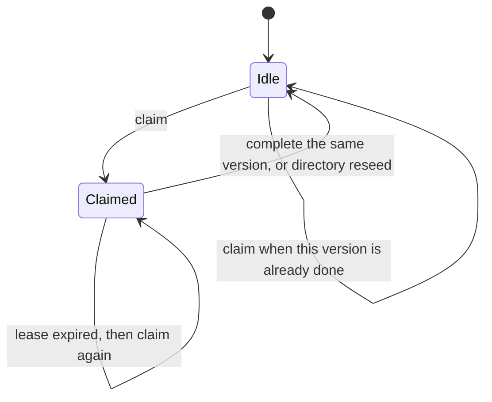

### Platform / flag differences

`wikiSeedEnabled` (`wiki/seed.ts`) requires `ENVIRONMENT === "dev"` and `WIKI_SEED` not `off`. Otherwise the result is `off` and the claim methods are not called. The flag is a guard in front of the function, not inside `seedClaim`.

## 19. Agent turn round

- Purpose: One assistant turn runs at most `AGENT_LIMITS.maxRounds` model rounds, spends a reservation per round, and either answers, fails, or runs tools and continues.
- Code: `src/state/agent-turn.ts` (`transitionAgentTurn`). Tests: `harness/tests/agent-turn-machine.test.ts`. `runLoop` calls the model and the tools, then applies the step.
- Persisted: no. There is no codec. `runLoop` does not write the turn.
- What changed: the stop-reason chain is the reducer. End, max tokens, an empty tool list, an unknown stop, and tools on the last round take the same branches as before. Tool results still count toward the turn cap, including calls that return an error. A stop event after the turn has answered is rejected and logged. The answer text stays on the round result. The reducer carries only the truncated flag.

### States

| State | Data carried | Meaning |
|---|---|---|
| round | round number, tool calls so far | About to reserve and call the model |
| tools | tool uses from this round | Need to execute tools and append messages |
| answered | truncated flag | Last round's text is the answer. The text itself stays on the round result |
| failed | `ai_budget_exhausted` or `ai_unavailable` | Stop |

### Events

| Event | Source |
|---|---|
| budget_denied | `reserve` returned null |
| upstream_failed | `streamRound` not ok |
| stop_end | `end_turn` or `stop_sequence` |
| stop_max_tokens | `max_tokens` |
| stop_tool | `tool_use` |
| stop_other | refusal, `pause_turn`, unknown, or `tool_use` with an empty list |
| tools_finished | Tool results appended |

### Transitions

| From | Event | Guard | To | Side effects |
|---|---|---|---|---|
| round | budget_denied | — | failed budget | no model call |
| round | upstream_failed | — | failed unavailable | settle already ran |
| round | stop_end | — | answered, not truncated | return |
| round | stop_max_tokens | — | answered, truncated | return |
| round | stop_other | — | failed unavailable | return |
| round | stop_tool | round is the last allowed, or tool list is empty | failed unavailable | tools are not run |
| round | stop_tool | an earlier round, and at least one tool use | tools | per-call limits stay in the tool map. They do not change the turn status |
| round | stop_tool | count is not a non-negative integer | rejected | the count is not logged |
| tools | tools_finished | `ran` is an integer from 0 through the tool-use count | round, round + 1, calls increased by `ran` | messages gain the assistant block and the tool results |
| tools | tools_finished | `ran` is larger than the tool-use count, or not an integer | rejected | nothing is added |

`startAgentTurn` with a max below 1 is already failed, so the loop does not run. With `AGENT_LIMITS.maxRounds >= 1` every real turn still leaves through a terminal state. A tool that runs and returns an error still counts. A use the loop refuses as over the cap does not: `tools_finished` adds `ran`, which is `toolUsesCounted`, not the whole list. An unhandled event is logged by `event.type` only.

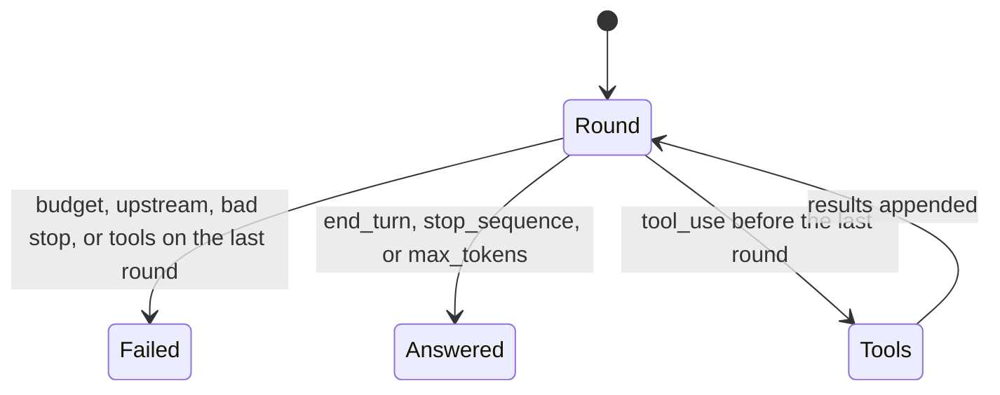

### Platform / flag differences

None. Limits come from `AGENT_LIMITS` in `ai/config.ts`.

## 20. SSE content assembly

- Purpose: Rebuild one assistant message from Anthropic server-sent events so the next round can send it back unchanged.
- Code: `src/state/sse-assembly.ts` (`transitionSse`). Tests: `harness/tests/sse-assembly-machine.test.ts`. `streamRound` reads the socket and runs `text` and `tool` effects.
- Persisted: no. There is no codec, so block text and tool input are not serialized. `streamRound` keeps the assembly for this request only.
- What changed: the frame switch is the reducer. Block text, tool JSON, thinking, signatures, citations, token sums, and the callbacks follow the old rules. A frame that used to return false is the `broken` state, and the round still fails with `upstream_error`. A frame after that is rejected and logged.

### States

| State | Data carried | Meaning |
|---|---|---|
| assembling | blocks, partial JSON, invalid indexes, model, stop reason, token counts, stopped flag | Accepting events |
| broken | — | This event cannot be applied. The round fails |

`onEvent` returns false for `broken` and for an illegal event. The read loop then fails the round.

### Events

| Event | Source |
|---|---|
| message_start, content_block_start, content_block_delta, content_block_stop, message_delta, message_stop | SSE `data:` JSON |
| error | Provider error event |
| other | `ping` and unknown types. Ignored, return true (208–209) |

### Transitions

| From | Event | Guard | To | Side effects |
|---|---|---|---|---|
| assembling | message_start | — | assembling | set model and input-token sum, including cache tokens |
| assembling | content_block_start | `hasBlockType` | assembling | copy the block. `tool` effect when the type is `tool_use` or `server_tool_use` |
| assembling | content_block_start | type missing | broken | round fails |
| assembling | content_block_delta | `canApplyDelta` | assembling | append text, JSON, thinking, signature, or citation. `text` effect for text. Other delta types are ignored |
| assembling | content_block_delta | block or delta missing | broken | round fails |
| assembling | content_block_stop | — | assembling | parse partial JSON if this index has a buffer. Invalid JSON marks the index. A stop for a missing block still returns true |
| assembling | message_delta | — | assembling | stop reason and usage |
| assembling | message_stop | — | assembling, stopped | the read loop may exit |
| assembling | error | — | broken | round fails |
| assembling | other | — | assembling | ignored |

A delta for an index that never started fails the whole round. There is no "skip this block" transition. `sseIndex` treats non-positive indexes as 0, so a missing index and index 0 share a slot. `hasBlockType` and `canApplyDelta` are the guards.

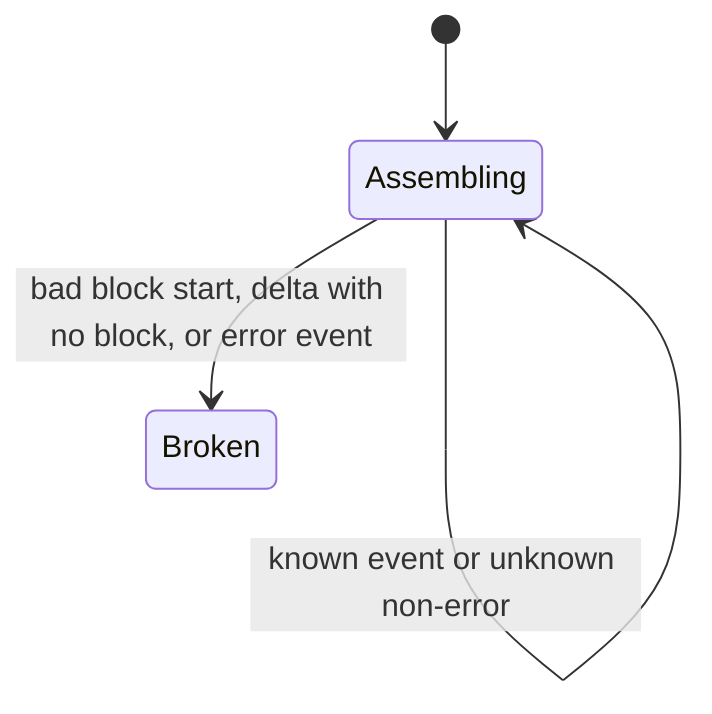

### Platform / flag differences

None.

## 29. Wiki job queue

- Purpose: A wiki job waits, runs, finishes, or is given up.
- Code: `forgetWikiJob` (`src/state/wiki-job.ts`) is the erasure transition. `MAX_ATTEMPTS` is 3 (`wiki/store.ts`). `wikiJobsDue` reclaims a `running` row whose claim is older than five minutes. An ingest job whose subject is still null is marked failed there and the log stores the id.
- Persisted: yes, `wiki_jobs.state`. The erased source is `wiki_jobs.subject` (`wiki/store.ts`). `sourceSubject` (`src/state/wiki-job.ts`) trims a text `sourceId` and maps blank or whitespace to null. `wikiEnqueue` computes it once and uses that value for the stored subject and the `wiki_sources` debounce lookup. Open rewrites a stored subject whenever `sourceSubject` of it differs from the stored text, including blank to null, and still fills a null subject from the payload.
- What changed: forgetting a source deletes pending, queued, and failed jobs for that subject and cancels a running one. `queued` is read as pending and then deleted. An ingest job that still has no subject is not claimed. Lint and dream jobs with no subject still are.

States are `pending`, `running`, `done`, `failed`, and `cancelled`. A due `pending` row becomes `running` and `attempts` increases. A `running` row older than five minutes returns to `pending`, or becomes `failed` when `attempts` is already 3. `done` and `failed` rows are deleted after 14 days. Erasure cancels `running` and does not delete it. `queued` reads as `pending` and is deleted with it. Any other word is unknown, is kept, and is not claimed.

## 30. Erasure / rights

A configure-role erasure removes a person, remembers that removal, and applies it again after a restore. The request itself is one reducer, `transitionErasure` (`src/state/erasure-request.ts`). `runErasure` performs the effects. The clock is `event.now`. Status is not authority. Resume runs only when `erasureGrantOk` (`src/state/erasure-request.ts`) sees two distinct approvers, the same subject, and every plan step inside the approved steps (`ops-admin.ts`). Anything else, including a row stored before the grant existed, decodes to `unreadable` (`decodeErasureLedger`) and needs a fresh quorum. The confirming call writes that grant in the same transaction as the pending_ops delete (`tenant-policy.ts`). A one-person ask writes no erasure row. A finished row is a new request: the new grant covers the new steps (`erasureWithGrant`), and only steps that ledger does not already contain run (`transitionErasure`). Nothing new stays `completed` and is not written. A restore has no grant of its own. `reapplyErasures` (`ops-rights.ts`) runs a row only when the same check passes, and only within that row's approved steps. A row that fails the check is skipped and listed on the restore result. `erasure_requests` stays outside `SNAPSHOT_TABLES`, so a grant survives a restore. Database write access is outside the threat model. The grant defends against damaged, legacy and partial rows, not against a DB writer. The receipt cursor is on this ledger. Tombstones and the other paths below are not this reducer.

The pseudonym rewrite is `wikiPseudonymise` at `wiki/store.ts`. The source-forget writes start at `wikiForgetSources`. The proposal scrub is the status `CASE` in `wikiForgetSources`. The citation walk is `citedSourceIds` (`src/state/proposal-citation.ts`).

Classification: **FIX** is a rights write that can leave a person or a scrubbed proposal readable. **LATER** is a retention or connector purge with its own clock. **NOT A MACHINE** stores no person or content transition. The safe state is absent or already replaced: an unknown or legacy word is not live personal data. A scrubbed proposal's safe status is `rejected`. A page's safe visibility is out of search. An unreadable tombstone expiry stays in force. A missing row is already safe.

| Path | Where | States touched | Class | Reason | Legacy / unknown | CAS, transaction, idempotency |
|---|---|---|---|---|---|---|
| Rights erase route | `ops-admin.ts` | One outcome. `completed` is HTTP `erased`. Any other machine status is 502 `erase_incomplete` with that status and step. Quorum gates every row whose grant does not cover the current plan, including a finished erasure and a row with no grant | FIXED | A proven in-progress row whose grant covers the plan resumes without a second quorum. A finished row asks again | An absent record still requires quorum. A missing grant, the same approver twice, a step outside the grant, corrupt JSON, an unknown status, a corrupt or missing mark, an unknown step, and a completed row whose marks are not all done are `unreadable` and require quorum. They are not rewritten on load. Rows from before the grant are in that set | The confirming delete and the grant write share one transaction (`tenant-policy.ts`). A one-person ask does not write the row. An unchanged completed row is not saved again |
| `eraseSubject` | `ops-rights.ts`, runner | `unreadable`, `requested`, `running`, `completed`, `partial_failed`. Step marks `pending`, `done`, `failed` | FIXED | `runErasure` drives `erasurePlan` (`src/state/erasure-request.ts`). A request on `unreadable` starts a fresh plan. A request on `completed` adds only missing steps. The clock is the `now` argument | `decodeErasureStatus` maps any other word, including null and `legacy`, to `unreadable`. `decodeErasure` rejects an unknown step, a mark map that is not an object, and a missing or unknown mark. `decodeErasureLedger` rejects a grant that fails `erasureGrantOk`. An explicit `failed` mark stays `partial_failed` when the grant is valid. Corrupt JSON and a completed row that is not all done are `unreadable`. A missing row is absent | A failed step is saved and stops that attempt. Resume retries a granted order. An unchanged ledger is not saved. This function does not call `Date.now` |
| Receipt pseudonym | `audit.ts` | `ReceiptErase` (`src/state/erasure-request.ts`): `done` with `rewritten`, `partial` with `rewritten` and `cursor`, `failed` with `reason`, `rewritten`, and `cursor`. `rejected` is not a position. Stored on the ledger as `receipts` | FIXED | A saved page is the next cursor. A crash continues there. A finished scan does not run again | A missing field starts at the first page. `legacy`, `unknown`, empty, and non-string cursors are not a position (`decodeReceiptCursor`) and are not sent on. A bad result shape is `rejected` (`decodeReceiptErase`), not `done` | The cursor and the count are one ledger row. `erasureSaveAtomic` (`tenant-policy.ts`) runs that write inside `transactionSync`. The clock is the caller's `now` (`ops-rights.ts`). The page is saved at `audit.ts` before the next fetch |
| Tombstone write | `tombstoneAdd` in `tenant-policy.ts` | One row per `principal_id`: `pseudonym`, `aliases`, `erased_at`, `expires_at`. Not in `SNAPSHOT_TABLES`, so a restore leaves it | FIXED | This is the memory a restore reapplies. A live row stays. An expired row, still unpurged, takes a new expiry so the window is live again. The request ledger records the step and does not change this write | A live second write leaves the row. There is no legacy status word. A missing row is inserted. An expired row changes only `expires_at`. Other columns stay in every case | One statement in `tombstoneAdd`. `ON CONFLICT(principal_id) DO UPDATE SET expires_at = excluded.expires_at WHERE erasure_tombstones.expires_at <= ?`. The `?` is the `now` argument, not a clock read inside SQL. A live row (`expires_at > now`) does not match, so it is not shortened or refreshed and the update trigger does not run. A repeat of a live row does not write |
| Tombstone read | `tombstoneList` in `tenant-policy.ts` | Reads rows with `expires_at > now` | NOT A MACHINE | A filter for re-apply. It writes nothing | A value that is not greater than now is omitted, so a corrupt expiry is not reapplied | No write |
| Tombstone drop | `tombstonePurge` in `tenant-policy.ts`, called from `ops-internal.ts` | Deletes `expires_at <= now` | LATER | Retention of the memory itself, after the backup window | A corrupt expiry matches neither `>` nor `<=`, so it is kept and not reapplied. Safe mapping: treat an unreadable expiry as still in force | `DELETE ... RETURNING`. A repeat deletes nothing. No compare of a previous status |
| Re-apply after restore | `ops-rights.ts`, called at `ops-internal.ts` | The same request states. `stepsForRestore` (`src/state/erasure-request.ts`) names the reopened steps, and `runErasure` performs them | FIXED | A tenant restore reopens `directory` when that step is in the row's grant. A personal restore reopens `personal`. A company restore reopens that scope. There is no second performer and no restore grant | A personal scope for someone else reopens nothing. A row without a valid grant is skipped and reported (`ops-rights.ts`, `ops-internal.ts`), never run | The clock is `restoredAt` at `ops-internal.ts`. Finished steps stay `done`. `erasure_requests` is outside `SNAPSHOT_TABLES`, so the grant survives the restore |
| Workspace pseudonym | `workspace.ts` | Rewrites `author_id`, `actor_id`, and `user_validated.by`. Drops search rows for non-seed items. Calls `wikiPseudonymise` | FIX | The person's id becomes one pseudonym in this workspace | A missing id changes nothing. Seed rows lose the search drop and still have `author_id` rewritten. `revisions.actor_id` is not in this update | One `transactionSync`. Equality updates match zero rows on a repeat. No status predicate |
| Wiki pseudonym rewrite | `wiki/store.ts` | Equality updates on `verified_by` and actor columns. `replaceName` (`src/state/pseudonym-text.ts`) on fact, page, revision, log, source title, promotion title, and record or wiki item text | FIXED | Text of the person is rewritten in place. Source item bodies are not in the list | `reindexPage` deletes the search row and inserts it only when `status === 'published'`. Archived, legacy, and unknown stay out of search | No compare-and-set. No transaction of its own; `pseudonymise` wraps it. Equality updates match zero rows on a repeat. `replaceName` matches the longer of the name and the pseudonym first, so a second call finds the name gone or already covered and writes nothing. Its precondition is that the pseudonym is never a strict prefix of the name: `pseudonymFor` (`ops-rights.ts`) returns `pz_` plus an HMAC, which is longer than the id. Matching is case-sensitive and has no word boundary, so a name inside a longer word is replaced on purpose. `wikiPseudonymise` does not text-replace a name shorter than 3 characters; the equality update on the actor id still runs |
| Personal wipe | `workspace.ts` | Deletes every `SNAPSHOT_TABLES` entry, including `WIKI_TABLES`. Returns the item count from before the delete | FIX | The Personal Brain is removed as a whole | An empty brain deletes nothing more. There is no status to misread | One `transactionSync`. A repeat on an empty brain returns 0. No predicate |
| Directory erase | `tenant-policy.ts`, invite list `pilotForget` at | Deletes the principal and the rows keyed by that id: identity, SCIM, sessions, roles, memberships, grants, elevations, rate, pending ops, agent grants. `principal_status` goes with them | FIX | The directory row is the person | A missing principal still runs the deletes and bumps the epoch. Any stored status word on those tables is deleted rather than read | One `transactionSync`. A repeat deletes nothing. No status compare-and-set. `pilotForget` rewrites a cohort member list by cohort id |
| Journal forget | `security-journal.ts` | `DELETE FROM security_journal WHERE a = ?`. Called inside `erasePrincipal` | FIX | Rows keyed by the principal id are removed. A switch row stores the switch name in `a`, so this delete does not select it. The tombstone is what reapplies the erase after a restore | A missing id deletes nothing. Kind is not consulted | Same transaction as `erasePrincipal`. A repeat deletes nothing |
| Connector cache forget | `connector.ts` | No local row. True only when the connector answers ok | LATER | Best effort. A false result does not undo the erase. The cache expires on its own | No connector, or any error, is false | No local compare-and-set or transaction |
| Forget source facts | `wiki/store.ts` | A fact with no remaining source is deleted. A fact that still has one is updated in place. No fact status column | FIXED | Derived knowledge of a gone source. Inside `wikiForgetSources`. The decision is `forgetFactSources` (`src/state/source-forget.ts`) | A fact that does not cite the source is left. An unreadable list is not a list: if its text quotes the gone id the fact is deleted, otherwise it is left. Unreadable hashes become `{}` | `WHERE id = ?` only. No compare-and-set. A second call changes nothing and does not throw. Callers `sourceDelete`, `remove`, and `purgeExpired` open `transactionSync` |
| Forget source pages | `wiki/store.ts` | Empty pages are deleted with their revisions and search row. A page that still has a line is rewritten. Status is not in the predicate | FIXED | Page text that cites the source. Search is rebuilt by `reindexPage`. A row that does not match the stored page is rebuilt by `pageIndexMatches`. An id absent from `wiki_pages` is deleted | Any status, including archived, legacy, and unknown, is deleted when the page is empty, and rewritten when it is not. `pageIndexMatches` (`src/state/source-forget.ts`) keeps a search row only for `published`. A legacy or unknown page that still has one loses it. Safe mapping: do not write `published` | `WHERE id = ?` only. No status compare-and-set. A second call finds the page and the search row already matching and writes nothing |
| Forget source revisions | `wiki/store.ts` | `markdown` of a revision that cites the source | FIXED | Old page text keeps the citation unless this runs | A revision that does not cite the source is left. There is no status on the revision | `WHERE page_id = ? AND revision = ?`. No compare-and-set. A second call finds no citation and writes nothing |
| Proposal scrub `CASE` | `wiki/store.ts` | `label` and `body` become an empty proposal titled `Erased source` in the same statement. `approved` and `rejected` keep their word. Every other word becomes `rejected`. Search row deleted in `wikiForgetSources`. Log title removed there. Sources deleted there | FIXED | A scrubbed proposal is not left readable under a legacy word. The clock is the caller's `now` | `approved` and `rejected` keep their word and lose the body. `legacy`, `pending`, and any other word become `rejected` with an empty body. A string element of `sources` is malformed and does not throw (`citedSourceIds`, `src/state/proposal-citation.ts`). A quoted id scrubs only when the body is malformed (`wiki/store.ts`). A well-formed rationale, finding key, or nested title equal to the id is left. A job word other than pending, queued, running, done, failed, or cancelled is kept | `WHERE id = ? AND status = ?`. The citation is decided before the write. Status is read before the writes, so a changed row matches nothing. Jobs match `subject = ?`, not the payload. Pending, queued, and failed are deleted. Running is cancelled at by `forgetWikiJob` (`src/state/wiki-job.ts`). `subject` is `sourceSubject` (`src/state/wiki-job.ts`) at enqueue and on open |
| Source delete and purge | `workspace.ts`, `sourcePurge` , connector `connector.ts` | Deletes `source_items` and the search row, then `wikiForgetSources` | LATER | The trigger is connector removal. The derived writes are the rows above | An unknown source id deletes nothing | `sourceDelete` is one `transactionSync`. `DELETE ... RETURNING` counts removed ids. A repeat removes nothing |
| Item remove | `workspace.ts` | Deletes the item, its comments, approvals, edits, contributions, revisions, and search row, then `wikiForgetSources` | LATER | A normal delete, not the rights route. It does purge derived wiki text | A missing id returns false and writes nothing | One `transactionSync`. A repeat returns false |
| Personal retention | `workspace.ts`, route `ops-internal.ts` | Deletes a `personalitem` whose label kind is `draft` or `brief` and whose `updated_at` is before that kind's cutoff, then `wikiForgetSources` | LATER | A retention clock. Not the rights reducer | An unknown kind has no cutoff and is kept. Safe mapping: do not guess a kind | One `transactionSync`. A repeat no longer sees the row. No status compare-and-set |
| Brain field retention | `brains/store.ts`, from `brainDaily` at | Deletes `brain_fields` past `retentionDays`, then values whose page is gone | LATER | Field retention. Not the rights reducer | A key that is not in the brain config is not age-deleted. An orphan page's values are deleted. Safe mapping: do not invent a retention for an unknown key | No transaction in `brainPurgeFields`. `DELETE ... RETURNING` counts the aged rows. A repeat deletes nothing new |
| Pseudonym key | `ops-rights.ts` | None. Returns `pz_` plus an HMAC, or null | NOT A MACHINE | A pure function. Null becomes `erase_disabled` and writes nothing | A short or missing key is null | No write |
| Dev wiki reset | `wiki/store.ts`, from `workspace.ts` when seed `reset` is set | Deletes every wiki table, and the seed path deletes the workspace tables first | NOT A MACHINE | Dev seed. Not a person erasure | No status is read | Inside the seed transaction. Not idempotent against a later seed insert in the same call |
| Journal age sweep | `security-journal.ts` | Deletes journal rows older than `JOURNAL_DAYS` on every append | NOT A MACHINE | A retention bound on append. The person path is `forget` | Age is the only. Kind is not read | Same statement as the insert. A row already older than the window is gone |
| Coach cache expiry | `brains/store.ts` | Deletes `brain_coach` rows with `expires_at < now` before a save | NOT A MACHINE | A cache TTL. Not person erasure | An unreadable expiry is not less than now, so it stays until a later save | `DELETE` then `INSERT OR REPLACE`. No status word |

## 31. Outbox dispatched flag

Not a machine. `outbox.dispatched` is created as `INTEGER NOT NULL DEFAULT 0` (`workspace.ts`). `outbox` inserts a row and does not set the flag. `outboxPending` reads `WHERE dispatched = 0`. No statement in this archive sets `dispatched` to 1, so the flag has a column and no transition.

## 21–28. Not machines

**21 Home screen.** The UI that would hold loading, empty, error, stale, partial, and populated is not in the archive. Server values that sound similar are #24 and the callout templates in `ai/planner.ts`.

**22 Recorder / LaunchAgent.** No source, plist, or comment. Evidence in the section above.

**23 Calendar refresh.** No job, cursor, or status. `isCalendarDay` is a.

**24 Coverage and account health.** `accountStatus` (`brains/insights.ts`) maps age in days to `active` (≤ 30), `watch` (≤ 90), or `dormant`. `brainCoverage` (622) and `pageCoverage` (640) map a count to `missing`, `low`, or `ok` against a fixed target. Nothing is stored and nothing transitions. Three labels with no ordering rule are a mapping.

**25 AI processor gate.** `aiState` (`ai/config.ts`) returns `disabled`, `contract_missing`, `not_configured`, or `ready`. The order is fixed and fail-closed. It is already one discriminated union of the environment. It is not a lifecycle: the next request computes it again. No persisted status.

**26 Import classifier.** A pure function from text to `skip`, `ask`, or `ingest`. Machine 11 consumes the verdict.

**27 Connector upsert.** `connector.ts` parses items and writes sources. Fail-closed access checks are predicates. The connector worker's own sync loop is not in this repo (`RECOVERY.md`).

**28 Session-report publish flag.** `brains/push.ts` sets `publishDirect` from `personal && publication === "direct"`. One boolean, no later states, no retry. The proposal it creates is machine 8.

Also reviewed and not listed as machines: notification `read` (one boolean), principal `active` (one boolean in the security journal), and `hit` rate windows (a counter, not a lifecycle of named states).
