# State machines in secondary-api-recovery (Second Brain API)

Last reviewed: 2026-11-11 at `bcf538e91aab4b6921abd6201cba5535c84a5229`

Standard: Implicit state machine standard v1 (2026-11-11), sha256 `c62dff48dc032e70df170c3161709ae7bfb79f1e25db473b730a300cedb82f0c`. No XState or other state-machine dependency. A plain reducer is the intended fix shape.

This repository is the recovered Secondary API Worker plus shared policy and contracts packages. It is not the static UI, not a LaunchAgent, and not the connector, ops, audit, or MCP workers. `recovered-source/` is byte-checked against `candidate-manifest.json` by `harness/tests/intake.test.ts`. This commit does not change those bytes. Later Low and Medium fixes, if they patch a recovered file, must keep the manifest as the intake record and list the patched path in that test. Canonical note text in `recovered-source/worker/src/wiki/seed-content.ts` stays untouched.

Risk used here:

- **High** — a wrong transition changes who is signed in, who may approve, what is published, or whether a signed call can be replayed. Not fixed on this branch. Waiting on review of this inventory.
- **Medium** — a real lifecycle whose failure is a duplicate dev seed, a double token settle, a wrong agent-round branch, or a bad stream frame. Decision: fix after this commit, one machine per commit.
- **Low** — a retry decision with no privilege effect. Decision: fix after this commit.

Status in the table matches the code on this branch. Devin approved this inventory with changes at `b527a8de`. High-risk rows stay LATER, except #13, whose guard now refuses a seen key after expiry, #6, whose login record is now one-shot, and #4, whose second-person check is now one typed result. The order and the right-sizing notes are in the review section below. Step 0 pinned the other High-risk behaviour in `harness/tests/characterization.test.ts` and did not change it.

## Inventory

| # | Machine | Location | Status | Risk | Decision | Notes |
|---|---|---|---|---|---|---|
| 1 | Governance change | `recovered-source/worker/src/admin/store.ts:18`, writers at 631, 662, 707, 738 | LATER | High | LATER | Two-person approval. Expiry is healed on read and not written back. |
| 2 | Elevation window | `admin/store.ts:38`, writers at 970, 995, 1039, 1062 | LATER | High | LATER | Pending and active expire only in `toElevation` (128–132). |
| 3 | Access request | `admin/store.ts:55`, writers at 1118, 1181, 1205, 912, 1216 | LATER | High | LATER | `reopenRequest` has no status predicate. |
| 4 | Second-person confirmation | `src/state/quorum.ts`, `requestSecond` in `tenant-policy.ts` | FIXED | High | FIX now | Typed result. The requester cannot confirm. A lost confirm is `replay` and does not apply. Callers: kill switch, field exposure, brain open, brain role, export, erasure, restore. #7 and #8 do not call it yet. |
| 5 | Kill switch | `tenant-policy.ts:754`, names in `switches.ts:3` | LATER | High | LATER | Off is immediate. On in prod waits for a second person. |
| 6 | OIDC login | `auth/routes.ts:103` | FIXED | High | FIX now | Login record is one-shot. Every terminal callback consumes the row. |
| 7 | Workspace item release | `workspace.ts:520`, `:730`, `:792`, `:810` | LATER | High | LATER | `update` (`workspace.ts:539`) stores the caller status. No current route can pass `approved`. Shares the quorum check with #4 and #8. |
| 8 | Wiki proposal review | `wiki/store.ts:1070`, `:1338`, `:1465` | LATER | High | LATER | Includes #10. Approval applies page markdown. Partial approval stays `candidate` while the API says `pending`. Shares the quorum check with #4 and #7. |
| 9 | Wiki page visibility | `wiki/store.ts:819` and `:1232` | LATER | High | LATER | Right-size to a status predicate plus an unarchive event. `savePage` currently republishes an archived page. |
| 10 | Wiki finding | `wiki/store.ts:1097`, `:1386`, `:1452` | FOLDED | High | part of #8 | `open` / `dismissed` / `resolved` are effects of proposal review. Not a separate reducer. |
| 11 | Brain import outcome | `brains/data.ts:332` and `:377` | LATER | High | LATER | Jarvis: a personal auto-accept stays a draft. One `publishMode()` defaults to draft, and publishing is an explicit action. Current formulas still disagree. |
| 12 | Brain member | `brains/store.ts:211`, set from `brains/routes.ts:704` | LATER | High | LATER | Caller passes `active` or `pending`. No transition check. |
| 13 | Replay nonce | `tenant-policy.ts:632` | FIXED | High | FIX now | Named guard, not a reducer. Expiry does not reopen a key. `expires_at` is strictly after the last accepted millisecond. Prune is outside the guard, and only for `expires_at < now`. |
| 14 | Model-call retry | `src/state/model-call.ts`, wired from `ai/anthropic.ts` | FIXED | Low | FIX now | Bounded retry. In-flight calls are not persisted. |
| 15 | Stream-open retry | `src/state/stream-open.ts`, wired from `agent/stream.ts` | FIXED | Low | FIX now | One retry, and only before the body is read. |
| 16 | Token-budget hold | `src/state/budget-hold.ts`, wired from `ai/budget.ts` | FIXED | Medium | FIX now | A second settle is rejected and does not adjust the counter. |
| 17 | Token-counter CAS retry | `src/state/budget-cas.ts`, wired from `ai/budget.ts` | FIXED | Medium | FIX now | Six attempts, then give up. Cap failure does not retry. |
| 18 | Wiki seed claim | `src/state/wiki-seed.ts`, wired from `tenant-policy.ts` and `wiki/seed.ts` | FIXED | Medium | FIX now | Dev only. An unexpired claim now blocks every version. Completing cannot move backwards. |
| 19 | Agent turn round | `src/state/agent-turn.ts`, wired from `agent/loop.ts` | FIXED | Medium | FIX now | Stop reason, budget, and the last-round tool ban are one reducer. |
| 20 | SSE content assembly | `src/state/sse-assembly.ts`, wired from `agent/stream.ts` | FIXED | Medium | FIX now | Frame order is one reducer. A bad frame still fails the round. |
| 21 | Home screen adaptive UI | not in this repo | NOT A MACHINE | — | NOT A MACHINE | Static UI was not recovered. See below. |
| 22 | Recorder / LaunchAgent | not in this repo | NOT A MACHINE | — | NOT A MACHINE | No matches. See below. |
| 23 | Calendar refresh | not in this repo | NOT A MACHINE | — | NOT A MACHINE | No refresh lifecycle. See below. |
| 24 | Coverage and account health | `brains/insights.ts:610` and `:622` | NOT A MACHINE | — | NOT A MACHINE | Pure thresholds. No events. |
| 25 | AI processor gate | `ai/config.ts:54` | NOT A MACHINE | — | NOT A MACHINE | Already a discriminated union, recomputed from env. |
| 26 | Import classifier | `uxv2/classifier.ts` | NOT A MACHINE | — | NOT A MACHINE | Pure verdict. The import machine is #11. |
| 27 | Connector upsert | `connector.ts:61` | NOT A MACHINE | — | NOT A MACHINE | Request handlers. No connection lifecycle in this repo. |
| 28 | Session-report publish flag | `brains/push.ts:212` | NOT A MACHINE | — | NOT A MACHINE | One boolean, one condition, no further states. |
| 29 | Wiki job queue | `wiki/store.ts:54`, `:618`–`:638` | LATER | Medium | LATER | `pending` / `running` / `failed`, plus `done`. A claim older than five minutes returns to `pending`, or `failed` after 3 attempts. |
| 30 | Erasure / rights | `ops-admin.ts:174`–`:189`; tombstones `tenant-policy.ts:979`–`:1008`; re-apply `ops-internal.ts:188` | LATER | High | LATER | Privacy. `erase_incomplete` is a 502 with no stored status. Tombstones outlive the person. A restore applies them again. |
| 31 | Outbox dispatched flag | `workspace.ts:181`, `:617`, `:671` | NOT A MACHINE | — | NOT A MACHINE | `dispatched` defaults to 0. `outboxPending` reads `dispatched = 0`. This archive never sets the flag. |
| 32 | Worker typecheck | `tsconfig.worker.json` | LATER | — | LATER | QA note: 119 pre-existing `typecheck:worker` errors. Not part of this machine work. |
| 33 | Login query state | `auth/routes.ts` callback mismatch | LATER | Low | LATER | A leaked query state can cancel another user's pending login. Denial of service only: no session is issued. Later, take the row by the cookie's state, and on a mismatch consume the cookie's row, never the row named only by the query. |

## Review notes

Devin approved the inventory at `b527a8de` with these changes. #6 is the login-record reducer. #4 is the quorum reducer. #7 and #8 do not call it yet. The other High-risk reducers are not written yet.

Right-sizing:

- **#13** stays a named guard, not a reducer. Expiry does not reopen a seen key. Fixed in `nonceFirst`.
- **#9** becomes a status predicate plus an unarchive event. It does not need a full page lifecycle.
- **#11** Jarvis: a personal-brain auto-accept import stays a draft, matching the dry run. The dry run and the real import share one `publishMode()` that defaults to draft. Publishing takes an explicit action. Not implemented yet.
- **#4, #7, and #8** share one quorum / second-person check.
- **#10** is folded into #8. Finding `open` / `dismissed` / `resolved` are effects of proposal review.

Approved High order. Step 0 found that no API route can set `approved` through `Workspace.update`, so #7 stays fourth.

1. #13 Replay nonce (fixed: a seen key stays refused)
2. #6 OIDC login (fixed: every terminal callback consumes the login row)
3. #4 Second-person confirmation (fixed: one typed check, and the requester cannot confirm)
4. #7 Workspace item release
5. #5 Kill switch
6. #2 Elevation window
7. #3 Access request
8. #12 Brain member
9. #1 Governance change
10. #9 Wiki page visibility
11. #11 Brain import outcome
12. #8 Wiki proposal review, with #10 folded in
13. Erasure / rights (#30)

Step 0 (`harness/tests/characterization.test.ts`) pins the current behaviour and marks the flagged cases. It does not fix them.

- **#7.** `workspace.ts:539` stores `patch.status ?? rec.status` and the `UPDATE` at 545 has no status predicate. The only caller that passes a status is `PUT /ux/accounts/:id/records/:rid` (`ux/records.ts:302`). `readFields` (`records.ts:161`) accepts a status only when it is in `STATUSES` (`records.ts:33`), which has no `approved`. `ux/personal.ts:105` and `:195` and `ux/records.ts:354` omit status. The method would store `approved`. No current route can send it, so this is not an approval bypass today.
- **#8.** `wikiDecide` (`wiki/store.ts:1338`). A short approval returns `status: "pending"` (`:1445`) and does not update the item, so the row stays `candidate`. The last approval calls `applyProposal` and sets `approved` (`:1448`). Reject sets the item to `rejected` and the finding to `dismissed` (`:1386`).
- **#9.** `savePage` (`wiki/store.ts:834`) sets `status = 'published'` with no status predicate. The unchanged-content skip (`:828`) applies only when the page is already published, so saving an archived page republishes it.
- **#11.** Dry-run state is `publishDirect ? "published" : "draft"` (`brains/data.ts:378` and `:389`). A real import reports `res.autoAccepted` (`:419`). `wikiPropose` (`wiki/store.ts:1117`) also auto-accepts a personal brain with `autoAccept`. A personal auto-accept can publish a replacement or an `ask` page that the dry run calls a draft. Jarvis's decision, recorded and not yet applied: both paths share `publishMode()`, which defaults to draft. A personal auto-accept stays a draft. Publishing is an explicit action.
- **#13.** `nonceFirst` (`tenant-policy.ts:632`) is `INSERT OR IGNORE ... RETURNING key`. True when one row comes back. The old `DELETE` of expired rows is gone, so a key is not accepted again after `expires_at`. The stored expiry is `(T + skew + 1)` seconds, strictly after the last millisecond the verifiers accept timestamp `T`.
- **#6.** Fixed. `commitLoginRecord` (`src/state/login-record.ts`) consumes an issued login on `idp_error`, `missing_state`, `state_mismatch`, `exchange_failed`, and `accepted`. A consumed record accepts nothing. The callback takes the cookie hash and, when it differs, the query hash, before it returns. Logs are reason codes. `loginStateTake` (`identity-store.ts:312`) still deletes the row and then returns null when it is already expired.

## Named areas that are not in this repo

Searches were `rg` over the repo for `LaunchAgent`, `launchd`, `recorder`, `calendarRefresh`, `refreshCalendar`, `CalDAV`, and `ical`, plus a file listing of `recovered-source/worker/src` (99 TypeScript files) and the root docs. `RECOVERY.md` lines 26–27 say the static UI is not here and that ops, MCP, audit, and connector workers are not here. `PROVENANCE.md` says the archive has no calendar, event, mail, or transcript data.

**Home dashboard adaptive states.** There is no Home screen and no client store with `loading` / `empty` / `error` / `stale` / `partial` / `populated`. The closest server values are pure mappings, listed as #24. `ai/planner.ts:27` names callout templates (`empty`, `stale`, `gap`, and others). Those are component kinds a model may pick, not a screen lifecycle. `uxv2/tree.ts` and `packages/policy/src/types.ts:94` derive `full` / `partial` / `locked` from what the viewer may read. That is a projection, not a machine. `brains/insights.ts:682` builds the Home sparkline as twelve counts. No status is stored.

**Recorder / LaunchAgent.** No file, comment, or string refers to a recorder, an audio capture session, or a LaunchAgent. Nothing to make explicit.

**Calendar refresh.** `brains/model.ts:198` `isCalendarDay` checks a `YYYY-MM-DD` string. `brains/data.ts:284` uses it to reject a bad journal date. Org seed data and the GenUI schema mention a calendar as content or as a view component. There is no calendar sync status, cursor, or refresh job in this repo.

## 1. Governance change

- Purpose: A directory change is proposed, then applied, rejected, withdrawn, or left to lapse.
- Code: no reducer yet. Writers are `GovStore.propose`, `decide`, and `withdraw` in `recovered-source/worker/src/admin/store.ts`.
- Persisted: yes, `gov_changes.status` (unversioned text). Read path `toChange` (109–114) shows `pending` as `expired` when `expires_at <= now` and does not write that back.
- What changed: nothing in this commit.

### States

| State | Data carried | Meaning |
|---|---|---|
| pending | payload, proposer, expiry, scope | Waiting, or applied in the same step when no second person is required |
| applied | decider, time | Directory write succeeded |
| rejected | decider, note | Second person refused |
| withdrawn | proposer | Proposer cancelled |
| expired | expiry time | Visible only. The row can still say `pending` |

### Events

| Event | Source |
|---|---|
| propose | Admin route |
| approve / reject | A different person (`decide`) |
| withdraw | Proposer |
| lapse | Clock, on read |

### Transitions

| From | Event | Guard | To | Side effects |
|---|---|---|---|---|
| (none) | propose | principal exists, no duplicate pending payload | pending | insert row; notify approvers if `needsSecond` |
| (none) | propose | `needsSecond` is false and `applyChange` succeeds | applied | directory write, bump epoch |
| (none) | propose | `applyChange` fails | (none) | row deleted inside the transaction (656–658) |
| pending | approve | not expired, not proposer, not beneficiary | applied | `applyChange`, then status write |
| pending | reject | same guards | rejected | no directory write |
| pending | withdraw | caller is proposer, not expired | withdrawn | status write |
| pending | lapse | `expires_at <= now` | expired | none (not stored) |

`decide` (674–717) and `withdraw` (729–745) check the healed status, then write. The check sits outside `tx`. One TenantPolicy object runs requests one at a time, so two decisions do not overlap inside one object. The rule is still not a single function, and a raw SQL reader can treat a lapsed row as `pending` because the stored status was not updated.

Anything not in this table is illegal. Today an unknown stored status is cast through (`as ChangeStatus`) and later refused only by the `not_pending` branch, which echoes the raw string.

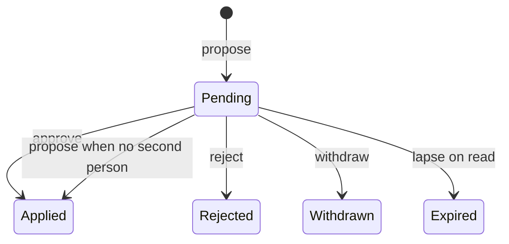

### Platform / flag differences

None inside the reducer. Whether a change needs a second person is decided by the route before `propose`.

## 2. Elevation window

- Purpose: A person asks for a time-boxed elevation, an admin approves or denies it, and the window can be ended early.
- Code: no reducer yet. `requestElevation`, `startElevation`, `decideElevation`, `endElevation` in `admin/store.ts`.
- Persisted: yes, `gov_elevations.status`. `toElevation` (128–132) rewrites `pending` and `active` to `expired` in memory when the clock has passed. The row is not updated. A second table, `elevations`, holds the window the policy engine reads.
- What changed: nothing in this commit.

### States

| State | Data carried | Meaning |
|---|---|---|
| pending | principal, hours, lapsesAt | Waiting for a configure holder, or about to start |
| active | until | Window open |
| denied | decider, note | Refused |
| ended | until set to now | Closed early |
| expired | lapsesAt or until | Read-time only |

### Events

| Event | Source |
|---|---|
| request | Admin route |
| approve / deny | Another admin |
| end | Requester or configure holder |
| lapse | Clock, on read |

### Transitions

| From | Event | Guard | To | Side effects |
|---|---|---|---|---|
| (none) | request | reason, whole hours, under role max, no open row | pending | insert |
| pending | request | `needsApproval` is false, same transaction | active | `startElevation`, bump epoch |
| pending | approve | not expired, decider is not the subject | active | insert `elevations` row, bump |
| pending | deny | not expired, not the subject | denied | notify |
| active | end | status is active after read-time healing | ended | shorten `elevations.until`, bump |
| pending | lapse | `lapses_at <= now` | expired | none stored |
| active | lapse | `until <= now` | expired | none stored |

`startElevation` (991) does not read the current status. It is only called after an insert or after `decideElevation`'s pending check. `endElevation` on a window that is past `until` sees `expired` and returns `not_active`, so the engine row is left until its own `until`.

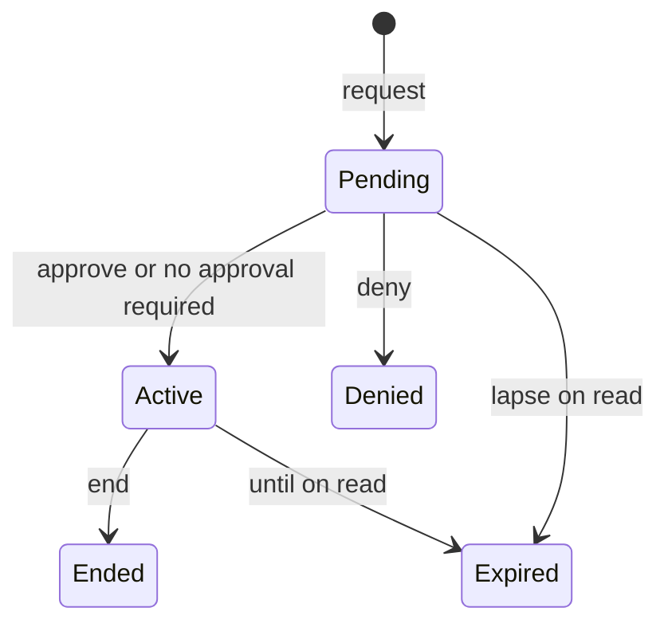

### Platform / flag differences

`needsApproval` is an input from the caller's role, decided before this store method.

## 3. Access request

- Purpose: A person asks to join a scope. A steward approves, a change fulfils it, or it is denied.
- Code: no reducer yet. `createRequest`, `denyRequest`, `markApproved`, `afterDecision`, `reopenRequest`.
- Persisted: yes, `gov_access_requests.status` (unversioned text).
- What changed: nothing in this commit.

### States

| State | Data carried | Meaning |
|---|---|---|
| pending | principal, scope, reason | In the queue |
| approved | decider | Steward said yes. Membership change may still be pending |
| granted | change id | The fulfilling change was applied |
| denied | decider, note | Refused, or the fulfilling change was rejected |

### Events

| Event | Source |
|---|---|
| create | Admin route |
| deny | Steward |
| mark_approved | Steward, before `propose` |
| change_applied / change_rejected | `afterDecision` (907–922) |
| reopen | `admin/routes.ts:843` and `:868` when the follow-up change cannot be made |

### Transitions

| From | Event | Guard | To | Side effects |
|---|---|---|---|---|
| (none) | create | reason, no pending or approved duplicate | pending | notify approvers |
| pending | deny | not the requester, note present | denied | notify |
| pending | mark_approved | not the requester | approved | none yet |
| approved | reopen | intended when already a member or `propose` fails | pending | clears decider and change id |
| pending or approved | change_applied | row linked by `change_id` | granted | notify |
| pending or approved | change_rejected | row linked by `change_id` | denied | notify |

Unguarded today: `reopenRequest` (1214–1218) sets `pending` with no `WHERE status = ...`. `afterDecision` (911–914) sets `granted` or `denied` with no status check. A granted request would reopen if `reopenRequest` were called on it. The current callers run only after `markApproved` succeeded, so the row should be `approved`, but the method itself does not enforce that.

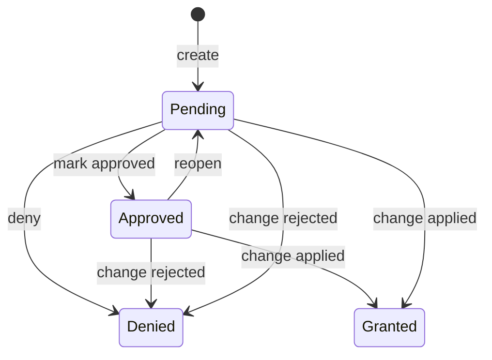

### Platform / flag differences

Restricted scopes need a second person on the membership change. That is machine 4, not a fork inside this status field.

## 4. Second-person confirmation

Review: one quorum check. #7 and #8 will reuse it and do not call it yet.

- Purpose: The first actor records an intent. A different human confirms it within 24 hours. The same human confirming does nothing.
- Code: `transitionQuorum` in `src/state/quorum.ts`. `TenantPolicy.requestSecond` performs the effects. Callers use `quorumConfirmed`.
- Persisted: yes, `pending_ops` (`key`, `requested_by`, `requested_at`). Unversioned. TTL is `SECOND_PERSON_TTL_MS` (24 hours).
- What changed: one typed result. The requester cannot confirm, compared by directory subject, then sign-in address, then id. A display name is not an identity. A confirm deletes only the row it read. If that delete matches nothing, the result is `replay` and the caller does not apply.

### States

| State | Data carried | Meaning |
|---|---|---|
| empty | key | Nothing waiting |
| waiting | requester identity, requestedAt | First person has asked and the row is inside the TTL |

An ask older than the TTL is an empty ask. The stored row is replaced.

### Events

| Event | Source |
|---|---|
| ask | Kill-switch re-enable, field exposure, brain open, brain role, rights export, erasure, ops restore |

### Transitions

| From | Event | Guard | To | Side effects |
|---|---|---|---|---|
| empty | ask | no row | waiting | upsert. Result `recorded` |
| waiting | ask | same actor | waiting | no write. Result `same_actor` |
| waiting | ask | different actor, `requestedAt > now - TTL`, delete matches | empty | delete that row. Result `confirmed` |
| waiting | ask | different actor, but the delete matches nothing | empty | no write. Result `replay`. Do not apply |
| waiting | ask | `requestedAt <= now - TTL` | waiting | replace the row. Result `recorded` |
| any | ask | clock is not a safe integer, or the actor id is blank | unchanged | no write. Result `refused`. Log reason code only |

`recorded`, `same_actor`, `replay`, and `refused` do not apply. Only `confirmed` does. The same actor does not refresh `requestedAt`. After a confirm, the next ask is a new `recorded`, not another confirm.

Same actor means the same id, or the same directory subject, or, when neither side has a subject, the same sign-in address. Two directory subjects are two people even when the address matches. The sign-in address is `gov_identity`, so two directory emails for one human do not count as two people.

Logs are `{ at: "illegal_transition", machine: "quorum", reason }` or `{ at: "quorum", reason: "replay" }`. The reason is a code. The line does not carry an id, a subject, or an address.

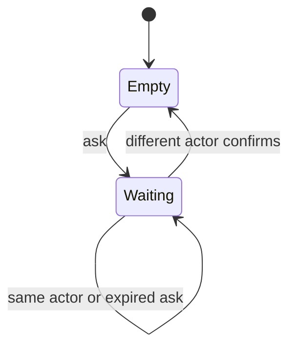

### Platform / flag differences

Callers decide whether to invoke this at all. Prod kill-switch re-enable does. Turning a switch off does not. A dev restore does not ask. #7 and #8 still pass their own id lists and do not use this result yet.

## 5. Kill switch

- Purpose: `mcp`, `connector`, `ai`, and `contribute` are on unless a row says off. Turning one off is immediate. Turning one on can wait for a second person.
- Code: no reducer yet. `setSwitch` at `tenant-policy.ts:754`. Defaults in `switches.ts:10` (`allOn`).
- Persisted: yes, `switches` plus a `pending_ops` row `switch:<name>`, and a journal entry outside the snapshot (772–773) so a restore cannot turn a switch back on.
- What changed: nothing in this commit.

### States

| State | Data carried | Meaning |
|---|---|---|
| on | changedAt or absent row | Enabled. Absence means on |
| off | changedBy, changedAt | Disabled |
| enable_pending | first actor, requestedAt | Prod re-enable waiting |

The pending flag lives in `pending_ops`, not in `switches.enabled`, so `enabled: false` plus a pending row is a pair of fields rather than one state.

### Events

| Event | Source |
|---|---|
| turn_off | Ops route, any one person |
| turn_on | Ops route |

### Transitions

| From | Event | Guard | To | Side effects |
|---|---|---|---|---|
| on or off | turn_off | none | off | write `enabled = 0`, delete pending, journal |
| on | turn_on | already on (`switchState`) | on | no write. Return `applied` |
| off | turn_on | `twoPerson` is false | on | write, journal |
| off | turn_on | `twoPerson`, quorum result is not `confirmed` | enable_pending | return `pending` |
| off | turn_on | `twoPerson`, quorum result is `confirmed` | on | write, journal |

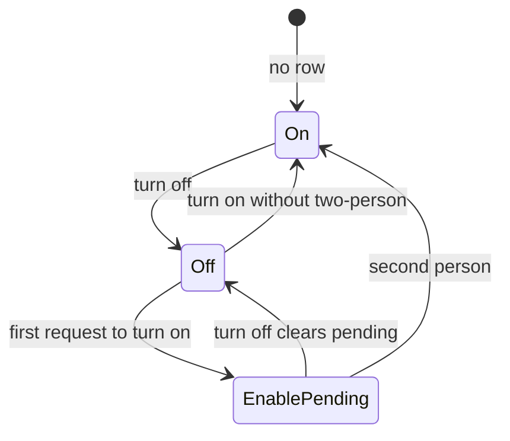

### Platform / flag differences

`twoPerson` is an argument. The ops route sets it for prod. That flag is an input to the guard, but the guard is inlined in `setSwitch` rather than named.

## 6. OIDC login

- Purpose: A browser starts Entra login, the callback is accepted once, and a session cookie replaces any session that browser already held.
- Code: `transitionLoginRecord` in `src/state/login-record.ts`. The route is `auth/routes.ts` `GET /callback`. `GET /login` and `POST /logout` stay as they were.
- Persisted: yes, a login record (`loginStatePut` / `loginStateTake`) and a session row (`sessionCreate` / `sessionDelete`). Unversioned. The row is the issued record. Taking it is the consume effect.
- What changed: an IdP error, a missing state, a mismatched state, a failed code exchange, and a successful callback all consume the login row. A consumed row cannot be used again. The log line is `{ at: "entra_login", reason }` and the reason is a fixed code.

### States

| State | Data carried | Meaning |
|---|---|---|
| anonymous | — | No session |
| issued | state hash, nonce, verifier, returnTo | Cookie plus stored record |
| consumed | — | The row has been taken. A replay is refused |
| session_open | session hash, tenant | Signed in |

### Events

| Event | Source |
|---|---|
| start | `GET /login` |
| idp_error | `GET /callback` with an IdP `error` |
| missing_state | `GET /callback` missing the cookie, the state, or the code |
| state_mismatch | `GET /callback` whose state does not match the cookie |
| exchange_failed | code exchange or token verification failed |
| accepted | `GET /callback` whose cookie, state, and code match |
| logout | `POST /logout` |

### Transitions

| From | Event | Guard | To | Side effects |
|---|---|---|---|---|
| anonymous | start | Entra configured, under IP limit, discovery works | issued | store record, set cookie, redirect |
| issued | idp_error, missing_state, state_mismatch, exchange_failed, or accepted | the record has not been taken | consumed | `loginStateTake` on the cookie hash and, when it differs, the query hash |
| consumed | any of those events | already taken | consumed | refuse. No second take |
| consumed | accepted, and the token, guest, and tenant checks pass | row was taken for this callback | session_open | create session, delete the previous session cookie's row |
| session_open | logout | same origin | anonymous | delete session, clear cookie |

The cookie is cleared before the take. The take still runs, because the handler already read the cookie value. A replay presents that value again and finds no row.

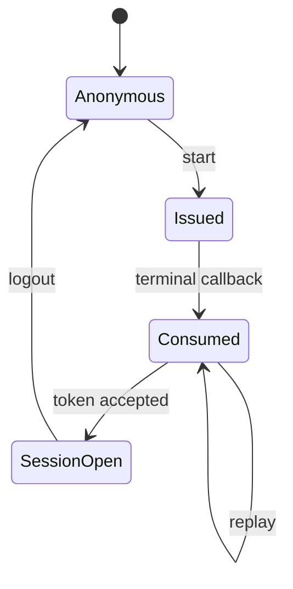

### Platform / flag differences

`entraEnabled`, `allowGuests`, and `scimConfigured` are guards on start and callback. They are read from env inside the handlers, not passed as named guard inputs.

## 7. Workspace item release

Review: shares the quorum check with #4 and #8. Step 0 pinned `update` at `workspace.ts:539`. No current route can pass `approved`, so this stays fourth in the High order. Still LATER.

- Purpose: A contributed item waits as a candidate until enough distinct people approve it. An edit of an approved item sends it back to review.
- Code: no reducer yet. `Workspace.update` (520), the contribute edit (730), `review` (775), `approve` (810).
- Persisted: yes, `items.status` as unconstrained text. There is no version tag on the status value.
- What changed: nothing in this commit.

### States

| State | Data carried | Meaning |
|---|---|---|
| draft | revision | Not in the release queue |
| candidate | revision, approvals | Waiting |
| approved | revision | Released |
| rejected | — | Used by the wiki path (machine 8), not by `Workspace.approve` |
| other | any string | `update` will store it |

### Events

| Event | Source |
|---|---|
| create / update | API, status taken from the caller |
| edit | Contribute path |
| review | Records a verdict only |
| approve | Release path |

### Transitions

| From | Event | Guard | To | Side effects |
|---|---|---|---|---|
| (none) | create | id is new | caller status | insert |
| any | update | expected revision matches | caller status, or the old status if omitted | new revision, clears `reviewed_by_2` |
| approved | edit | revision matches | candidate | new revision |
| draft or candidate | edit | revision matches | same status | new revision |
| candidate | review | not an author | candidate | upsert a review row. Status unchanged |
| candidate | approve | not an author, this human has not approved this revision, approvals reach `required` | approved | outbox `item.released` |
| candidate | approve | approvals still short | candidate | approval row only |

`required` is 2 for a global release or `GLOBAL_NONPERSONAL`, otherwise 1 (`workspace.ts:138`). `update` at line 539 assigns `patch.status` with no allow-list. That is the unguarded transition: any string becomes the stored status, including from `approved` straight to a made-up value, skipping the candidate rule the edit path uses. The comment on that line records the hole. `STATUSES` still has no approval word, so the record route cannot send one.

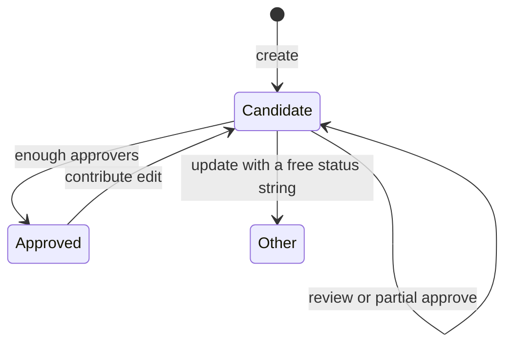

### Platform / flag differences

Global versus scope changes `required`. It is data on the item (`releaseTarget`, `plane`), not a hidden branch in a second status field.

## 8. Wiki proposal review

Review: includes machine 10. Shares the quorum check with #4 and #7. Still LATER. Step 0 pinned the pending-versus-candidate split.

- Purpose: A wiki proposal is a workspace item of kind `wiki_ingest`, `wiki_lint`, or `wiki_dream`. Deciding it applies or discards a diff.
- Code: no reducer yet. `wikiPropose` (around 1086–1126), `wikiDecide` (1338), `wikiEditProposal` (1465), and the erase scrub (1927).
- Persisted: yes, the same `items.status` column as machine 7. Response field `status: "pending"` (1445) is not the stored status. The row stays `candidate` until the last approval.
- What changed: nothing in this commit. Applying a proposal writes page bodies. This machine stays High so that write path is not edited in this pass. `wiki/seed-content.ts` is not part of the machine.

### States

| State | Data carried | Meaning |
|---|---|---|
| candidate | revision, body, approvals | Open |
| approved | — | Diff applied, or auto-accepted |
| rejected | — | Discarded, or scrubbed because a source was erased |
| pending | approvals, required | Response only, while stored status is still candidate |

### Events

| Event | Source |
|---|---|
| propose | Import, push, routines, engine |
| approve / reject | `wikiDecide` |
| edit | `wikiEditProposal` |
| erase_source | Retention scrub |
| auto_accept | `publishDirect`, personal `autoAccept`, or dev seed |

### Transitions

| From | Event | Guard | To | Side effects |
|---|---|---|---|---|
| (none) | propose | payload parses | candidate | optional finding row `open` |
| candidate | auto_accept | dev seed, or ingest and (`publishDirect` or personal autoAccept) | approved | `applyProposal` writes pages |
| candidate | reject | not an author (personal brain skips that check) | rejected | finding `dismissed` if any |
| candidate | approve | revision hash matches, pages not stale, this human has not approved, count still short | candidate | response `pending` |
| candidate | approve | count reaches `required` (1 in a personal brain, else the item's required) | approved | `applyProposal`, finding `resolved` |
| candidate | edit | page exists, not generated, markdown non-empty | candidate | revision + 1, prior approvals no longer match |
| candidate | erase_source | proposal cites the erased source | rejected | body replaced with an empty proposal |
| approved or rejected | erase_source | same | stored status unchanged | body still scrubbed (1927 `CASE`) |

Authors cannot decide a non-personal proposal. A second approval by the same human returns `already_done`. Those checks are inside `wikiDecide`, not a shared table with machine 7, which has its own copy for non-wiki items.

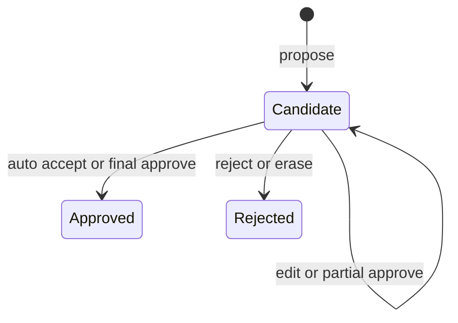

### Platform / flag differences

`ENVIRONMENT === "dev"` plus `opts.seed` auto-approves seed origin (1111). Personal scope forces `required = 1` (1418). Both are inputs that should be guards. They are branches in the method today.

## 9. Wiki page visibility

Review: the fix is a status predicate plus an unarchive event, not a larger lifecycle. Step 0 pinned that `savePage` republishes an archived page. Still LATER.

- Purpose: A page is readable while `published`. Archiving hides it. Saving a page publishes it.
- Code: no reducer yet. `savePage` (819) and the archive loop (1229).
- Persisted: yes, `wiki_pages.status`. The type says `"published" | "archived"` (`wiki/types.ts:88`). The column is unversioned text.
- What changed: nothing in this commit.

### States

| State | Data carried | Meaning |
|---|---|---|
| published | revision, markdown | In search and default lists |
| archived | revision | Hidden from search. Still loadable when archive is included |

### Events

| Event | Source |
|---|---|
| save | `applyProposal` and other writers of `savePage` |
| archive | Proposal `archive` ids |

### Transitions

| From | Event | Guard | To | Side effects |
|---|---|---|---|---|
| (none) | save | — | published | insert revision 1 |
| published | save | title or markdown changed | published | revision + 1 |
| published | save | title and markdown unchanged | published | no write (828) |
| archived | save | any content change, and also an unchanged check that only skips when status is already published | published | `UPDATE` sets `status = 'published'` with no status predicate (834) |
| published | archive | `WHERE status = 'published'` | archived | drop the search row |
| archived | archive | the `WHERE` misses | archived | no write |

The archive statement is guarded. The save statement is not: an archived page becomes published as soon as a proposal saves it. There is no explicit unarchive event. That is the unguarded transition.

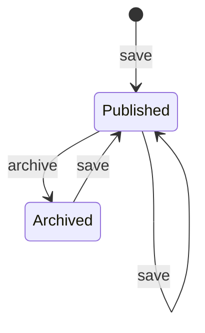

### Platform / flag differences

None.

## 10. Wiki finding

Folded into #8. These states are effects of proposal review. Do not write a separate reducer. The transitions below stay as the record of the current writes.

- Purpose: A lint or ingest finding tracks whether the proposal that would fix it is still open.
- Code: no reducer yet. Insert at 1097, dismiss at 1386, resolve at 1452.
- Persisted: yes, `wiki_findings.status`. Unversioned. No check that `dismissed` is not later marked `resolved` on the same key by a different proposal.
- What changed: nothing in this commit.

### States

| State | Data carried | Meaning |
|---|---|---|
| open | key, kind, proposal id | Created with the proposal |
| dismissed | — | Proposal rejected |
| resolved | — | Proposal approved and applied |

### Events

| Event | Source |
|---|---|
| open | `wikiPropose` when `findingKey` is set (`INSERT OR IGNORE`) |
| dismiss | reject branch |
| resolve | final approve branch |

### Transitions

| From | Event | Guard | To | Side effects |
|---|---|---|---|---|
| (none) | open | — | open | insert |
| open | open | same key | open | ignored |
| open | dismiss | reject path | dismissed | no status predicate on the UPDATE |
| open | resolve | approve path | resolved | no status predicate |

Both updates are unguarded. A dismissed finding can be overwritten to `resolved` if a later approval names the same key.

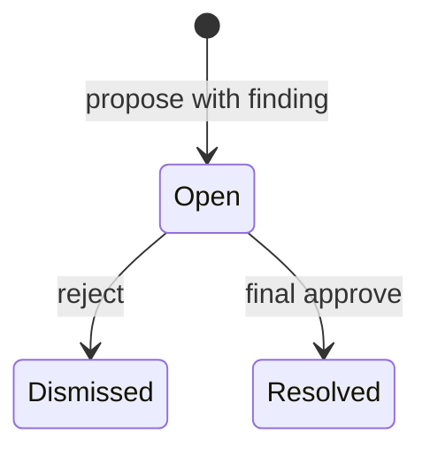

### Platform / flag differences

None.

## 11. Brain import outcome

Review: Jarvis decided that a personal-brain auto-accept import stays a draft, matching the dry run. The dry run and the real import will share one `publishMode()` that defaults to draft, and publishing takes an explicit action. Step 0 pinned that the two formulas still disagree. Still LATER. Not implemented in this change.

- Purpose: Each file in an OKF, Obsidian, or Outline import is skipped, shown as a dry-run page, or written as a draft proposal or a direct publish.
- Code: no reducer yet. `runImport` in `brains/data.ts:332`. Parsers in `brains/importers.ts` only build documents. They do not publish.
- Persisted: the proposal and page rows are machines 8 and 9. The import response itself is not stored. `state: "published" | "draft"` on the JSON (325–329, 389, 419) is computed twice.
- What changed: nothing in this commit. Left High because a wrong branch publishes a page.

### States

| State | Data carried | Meaning |
|---|---|---|
| incoming | path, markdown | Parsed document |
| skipped | reason | Classifier skip, empty, reserved page, or propose failure |
| dry | verdict, replaces, would-be state | `dryRun=1`. No write, no audit |
| proposed | proposal id, published or draft | Real import |

### Events

| Event | Source |
|---|---|
| classify | `classify` |
| existing_page | `wikiPage` |
| propose_result | `wikiPropose` |

### Transitions

| From | Event | Guard | To | Side effects |
|---|---|---|---|---|
| incoming | classify | verdict `skip` or empty kept text | skipped | none |
| incoming | existing_page | page type is generated or `journal` | skipped | `reserved_page` |
| incoming | dry | `dry` query is `1` | dry | `publishDirect` is reported, nothing stored |
| incoming | propose_result | not dry, propose created | proposed | audit already written for the whole import (261) |
| incoming | propose_result | propose refused | skipped | reason from the stub |

`publishDirect` (378) is `personal && verdict === "ingest" && !cur`. The response state for a real import (419) is `res.autoAccepted`, not `publishDirect`. `wikiPropose` also auto-accepts when `opts.autoAccept && personal && autoAccept` (1117–1124). A personal brain that auto-accepts can report `published` for a page that replaces an existing one, while the dry-run branch would have reported `draft` because `cur` makes `publishDirect` false. The two branches do not share a function. Whether that split is intentional is left for review. It is not changed here.

Ordering that is easy to miss: a real import audits once before the per-page loop (261–269). A dry run returns before that audit (260). A failed audit returns 503 and writes nothing.

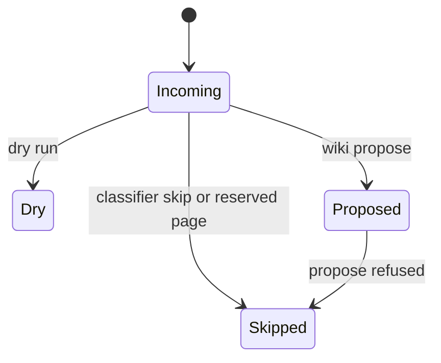

### Platform / flag differences

The `imports` flag is checked before the handler body (`needFlag`). Personal versus shared is the `publishDirect` input. Both are outside a named guard.

## 12. Brain member

- Purpose: A person has a stored brain role that is either already in force or waiting on a directory change.
- Code: no reducer yet. `brainMemberSet` (`brains/store.ts:211`) writes the caller's `state` argument. `brains/routes.ts:675` and `:710` choose `active` when the governance change applied, otherwise `pending`.
- Persisted: yes, `brain_members.state` (`active` or `pending`). Unversioned. Remove deletes the row.
- What changed: nothing in this commit.

### States

| State | Data carried | Meaning |
|---|---|---|
| absent | — | No row |
| pending | role, actor | Directory change not applied yet |
| active | role, actor | In force |

### Events

| Event | Source |
|---|---|
| set | Member route |
| remove | Member route when role is null and the directory change applied |

### Transitions

| From | Event | Guard | To | Side effects |
|---|---|---|---|---|
| absent or any | set | caller passes `active` | active | upsert, wiki log |
| absent or any | set | caller passes `pending` | pending | upsert, wiki log |
| active or pending | remove | directory removal already applied | absent | delete |

There is no guard against `pending → active` except the route's `status === "applied"` check, and `brainMemberSet` will also write `active` over `pending` if any caller asks. `ON CONFLICT` replaces role and state unconditionally (219–220).

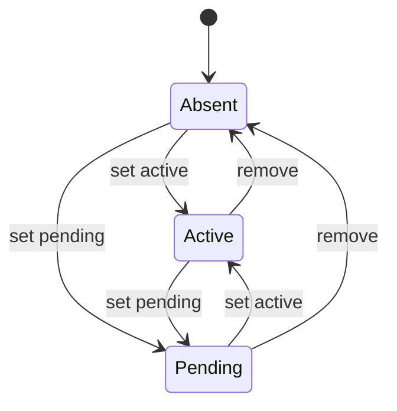

### Platform / flag differences

Restricted brains and heavy roles on a global brain set `needsSecond` before this write (`brains/routes.ts:644`). That uses machine 4.

## 13. Replay nonce

- Purpose: A signed internal call's nonce is accepted once. Seeing it again is refused for the caller's replay window and after that window, because expiry does not delete the row.
- Code: a named guard, `nonceFirst` at `tenant-policy.ts:632`. It is not a reducer. Tests call that method on real SQLite in `harness/tests/nonce-first.test.ts` and `harness/tests/nonce-retention.test.ts`. The in-memory double in `harness/tests/contracts-security.test.ts:26` still only copies accept-once for the HMAC tests.
- Persisted: yes, `nonces` (`key` primary key, `expires_at`). Unversioned. `expires_at` records the window. It is not a reason to forget the key.
- What changed: the `DELETE` of rows with `expires_at <= now` is not part of accepting a key. `INSERT OR IGNORE ... RETURNING key` is the whole guard. One row returned means accept. No row means the key was already stored, including when the stored window has passed. `verifyInternalRequest` and `verifyOpsRequest` reject a timestamp outside the shared clock skew before `nonceFirst` runs. On insert, `expires_at` is derived from the token time and that window, not from the receive time. An unsafe bound is refused and not stored. `pruneNonces` deletes only rows with `expires_at < now`, and it is not called from `nonceFirst`.

### States

| State | Data carried | Meaning |
|---|---|---|
| unseen | — | No row for this key |
| seen | expiresAt | Accepted once. Later presents are refused |

### Events

| Event | Source |
|---|---|
| present | `verify` of an internal request |

### Transitions

| From | Event | Guard | To | Side effects |
|---|---|---|---|---|
| unseen | present | `INSERT OR IGNORE` returns a row | seen | caller accepts the request |
| seen | present | insert ignored, including when `expires_at <= now` | seen | caller rejects |

The guard has no expire transition back to unseen. Both verifiers share `MAX_SKEW_SECONDS` and `CLOCK_GRANULARITY_MS` (`signed-call.ts`). They accept timestamp `T` while the floored unix second `now_s` satisfies `|now_s - T| <= MAX_SKEW_SECONDS`, so the last accepted instant is `(T + MAX_SKEW_SECONDS) * CLOCK_GRANULARITY_MS + (CLOCK_GRANULARITY_MS - 1)`. `expires_at` is `(T + MAX_SKEW_SECONDS + 1) * CLOCK_GRANULARITY_MS`, which is strictly greater than that instant, and it does not depend on when the request arrived. `pruneNonces` deletes a row only when `expires_at < now`, which is already after every instant either verifier will accept `T`. A replay then fails the timestamp check and does not reach `nonceFirst`. It is High because it is the replay gate for connector, MCP, and ops calls. The fix stays this guard. It does not add a reducer.

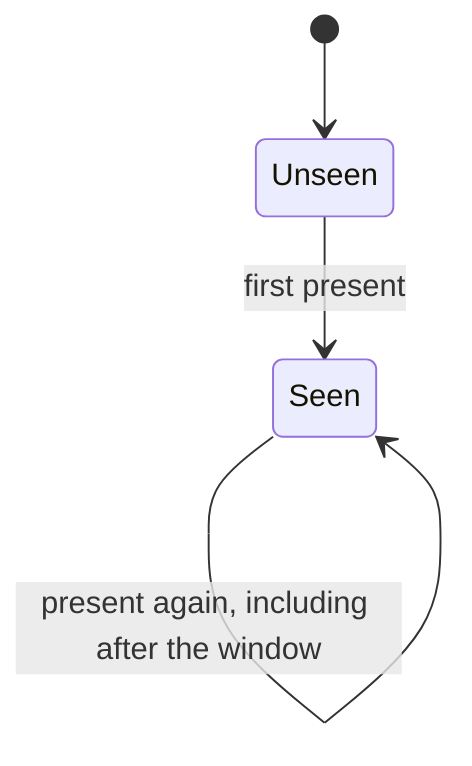

### Platform / flag differences

With a bound, the stored expiry is `nonceExpiresAt` (the token time plus the shared clock window). The `ttlMs` argument does not set it. Without a bound, `ttlMs` is still the stored lifetime.

## 14. Model-call retry

- Purpose: One non-streaming Messages call retries bounded HTTP failures and stops on a terminal body.
- Code: `src/state/model-call.ts` (`transitionModelCall`). Tests: `harness/tests/model-call-machine.test.ts`. `callModel` fetches and sleeps from the effect list.
- Persisted: no. There is no codec. A reply's text stays in the call result and is not written.
- What changed: the retry decision moved into the reducer. `callModel` still returns the same reply for the same responses. A 2xx status sent as an HTTP failure is rejected and logged. The caller classifies a 2xx body instead, which is what the old loop did. Sleep stays `250 * 2 ** (attempt - 1)` before the next fetch. NaN, Infinity, and a negative retry count fail closed instead of looping.

### States

| State | Data carried | Meaning |
|---|---|---|
| calling | attempt index, retries allowed, last failure code | About to send, or about to send again |
| done | reply | Returned to the caller |

The loop is `for (attempt = 0; attempt <= retries; attempt++)`. Sleep before attempt `n > 0` is `250 * 2 ** (n - 1)` milliseconds. A negative or non-numeric `retries` does not enter the loop and returns `upstream_error`.

### Events

| Event | Source |
|---|---|
| http status | `fetch` response |
| timeout | `AbortError` |
| transport | any other throw |
| refused / truncated / empty / success | parsed body, only after a non-retryable 2xx |

### Transitions

| From | Event | Guard | To | Side effects |
|---|---|---|---|---|
| calling | retryable status (408, 409, 429, 500, 502, 503, 504, 529) | `attempt < retries` is the wrong test for a non-integer; the loop retries while `attempt + 1 <= retries` | calling, last = `upstream_error` | sleep, then another fetch |
| calling | retryable status | no attempt left | done `upstream_error` | return |
| calling | other HTTP error | none | done `upstream_error` | return immediately, attempts left unused |
| calling | timeout or transport | another attempt fits | calling, last = `timeout` or `upstream_error` | sleep, retry |
| calling | timeout or transport | no attempt left | done with that code | return |
| calling | refusal, truncation, empty, success | body was ok | done | return immediately |

A retryable status never becomes `timeout`. A fatal HTTP status does not retry. That split is two `if`s, not a table. Terminal `done` plus another event is not representable because the function has already returned.

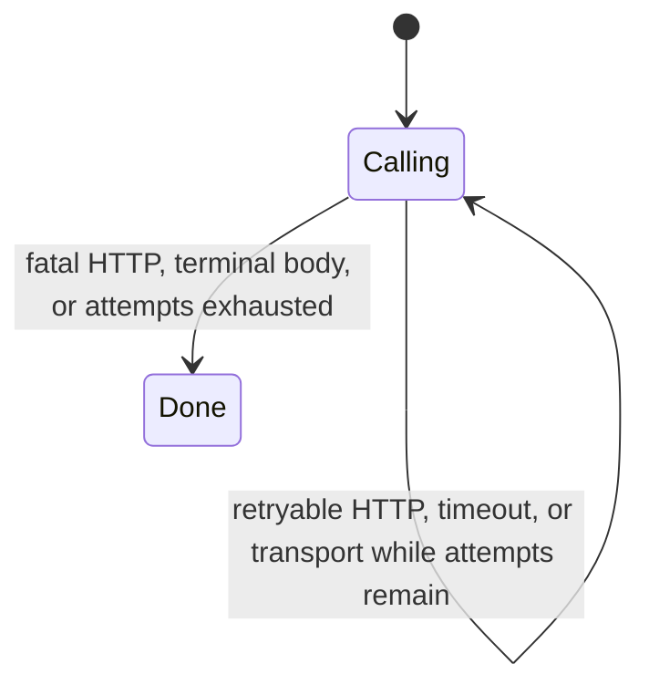

### Platform / flag differences

None. `retries` and `timeoutMs` come from the request.

## 15. Stream-open retry

- Purpose: One streaming round may retry a retryable HTTP status once, and only before any event byte is parsed.
- Code: `src/state/stream-open.ts` (`transitionStreamOpen`). Tests: `harness/tests/stream-open-machine.test.ts`. `streamRound` fetches, cancels, and sleeps from the effect list.
- Persisted: no. There is no codec. The open attempt lives only for this request.
- What changed: the open/retry decision moved into the reducer. A retryable status still retries once, with the same 250ms delay, and only from the first attempt. Each attempt arms its own abort timer, and that timer is cleared before the retry sleep, so the wait does not consume the next attempt's timeout. A timeout or a throw still fails the round with no second try, including after the body is being read. An HTTP event after the body was accepted is rejected and logged.

### States

| State | Data carried | Meaning |
|---|---|---|
| opening | attempt 0 or 1 | Request in flight, body not parsed |
| streaming | response body | Retry is no longer allowed |
| failed | `upstream_error` or `timeout` | Round failed before a successful parse |

### Events

| Event | Source |
|---|---|
| http status | Response headers |
| timeout / transport | Outer catch, which also covers the read loop |

### Transitions

| From | Event | Guard | To | Side effects |
|---|---|---|---|---|
| opening attempt 0 | retryable status | attempt is 0 | opening attempt 1 | cancel body, sleep 250ms |
| opening attempt 1 | retryable status | — | failed `upstream_error` | do not read |
| opening | non-ok, non-retryable | — | failed `upstream_error` | cancel body |
| opening | ok with a body | — | streaming | parse SSE (machine 20) |
| opening | ok without a body | — | failed `upstream_error` | — |
| opening or streaming | timeout | — | failed `timeout` | no second try |
| opening or streaming | other throw | — | failed `upstream_error` | no second try |

The file comment matches the code: the retry decision happens before `getReader`, and the abort timer is per attempt. A 200 that later breaks is not retried. Timeout does not use the attempt loop. That difference from machine 14 is implicit.

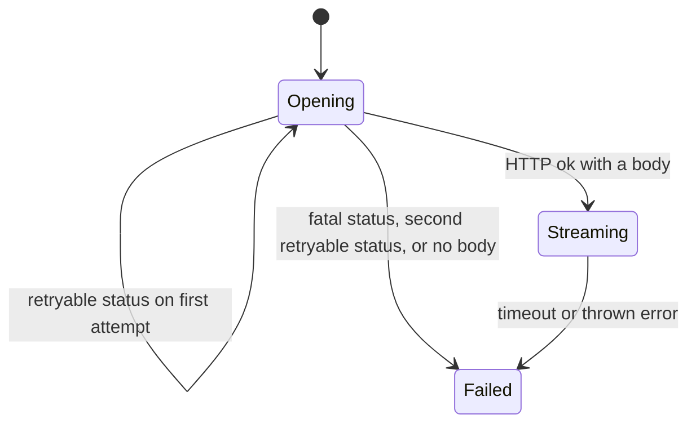

### Platform / flag differences

None.

## 16. Token-budget hold

- Purpose: Reserve an estimate before a model call and settle to the real token count after it.
- Code: `src/state/budget-hold.ts` (`transitionBudgetHold`). Tests: `harness/tests/budget-hold-machine.test.ts`. `reserve` applies the `adjust` effect.
- Persisted: the day counter is a workspace row (`ai:usage`). The hold is request-local and has no codec. `reserve` does not write it.
- What changed: `settle` is once only. A second call is logged and does not add the diff again. A non-finite estimate is rejected before `store.add`. If the settle diff itself fails to write, that failure is logged with no amounts and the hold stays settled. `withUserCap` logs a refund that returns null, still with no amounts. Making that refund idempotent is later. If the refund does not land, the user counter stays high.

### States

| State | Data carried | Meaning |
|---|---|---|
| idle | — | Nothing reserved |
| held | estimate | `store.add(estimate)` succeeded |
| denied | — | Cap would be exceeded. `reserve` returns null |
| settled | actual | Difference applied once |

### Events

| Event | Source |
|---|---|
| reserved / denied | Result of `store.add` |
| settle | Caller after the model returns (`agent/loop.ts:116`, and the other `reserve` callers) |

### Transitions

| From | Event | Guard | To | Side effects |
|---|---|---|---|---|
| idle | reserved | add returned a total | held | estimate already added |
| idle | denied | add returned null | denied | `reserve` returns null |
| held | settle | finite actual | settled | `add(Math.round(actual) - estimate)` when the diff is non-zero, cap `MAX_SAFE_INTEGER` so the settle is not refused |
| settled | settle | — | rejected | `openHold` returns before `store.add`, so the diff is not applied again |

The refund path in `withUserCap` is separate: if the user add succeeds and the tenant add returns null, it tries `user.add(-tokens)`. If that refund add also returns null, the user counter stays high and the tenant counter does not move. That gap is not fixed with this machine. It is called out so a later review does not treat the hold fix as covering it.

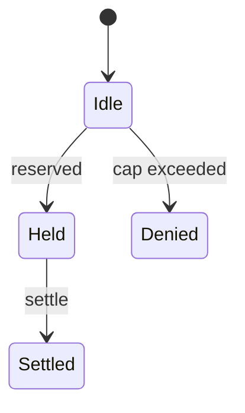

### Platform / flag differences

None. The cap is an argument.

## 17. Token-counter CAS retry

- Purpose: Add tokens to the day row using the row revision as a compare-and-set, and retry when another request wrote first.
- Code: `src/state/budget-cas.ts` (`transitionBudgetCas`). Tests: `harness/tests/budget-cas-machine.test.ts`. `doBudget` reads and writes the row, then applies the step.
- Persisted: the counter body is the total. `decodeUsageBody` reads it: empty is 0, a canonical non-negative integer is that total, and anything else (corrupt, negative, NaN) is the cap already reached. The log names the row key and not the cell. The attempt is request-local and has no codec. `doBudget` does not write the attempt.
- What changed: continue versus stop moved into the reducer. Six attempts and an immediate cap refusal are unchanged. A `wrote` or `over_cap` event after the attempt has finished is rejected and logged.

### States

| State | Data carried | Meaning |
|---|---|---|
| trying | attempt 0..5 | Read or write in progress |
| committed | new total | `edit` returned ok |
| refused | — | Positive add would pass the cap, or six attempts failed |

### Events

| Event | Source |
|---|---|
| over_cap | positive add would exceed `cap`, or the stored body is unreadable |
| wrote | `edit` ok. Carries the new total |
| retry | `doBudget` maps a missing row (get or create yielded nothing) and a failed edit onto this event |

### Transitions

| From | Event | Guard | To | Side effects |
|---|---|---|---|---|
| trying | over_cap | — | refused | return null immediately, remaining attempts unused. The row is not edited |
| trying | wrote | — | committed | return the new total |
| trying | retry | `attempt + 1 < 6` | trying | loop |
| trying | retry | attempt is 5 | refused | return null |

The cap check is not retried. A missing row and a failed edit are. `doBudget` is what turns those two outcomes into `retry`.

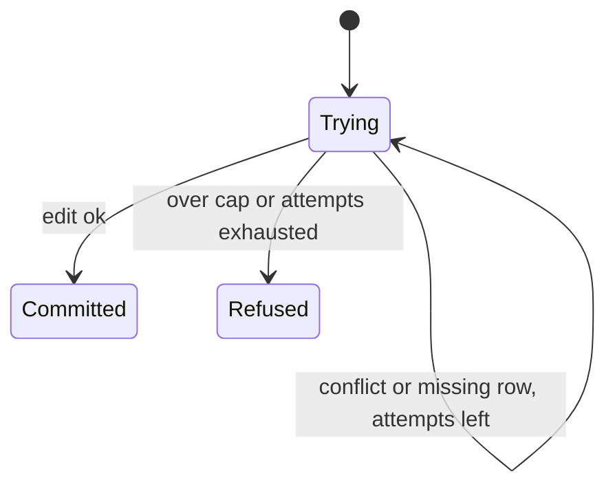

### Platform / flag differences

None.

## 18. Wiki seed claim

- Purpose: In dev, one request runs the synthetic wiki seed for a version. Others see current, busy, off, or unseeded.
- Code: `src/state/wiki-seed.ts` (`transitionWikiSeed`, `seedRunStatus`). Tests: `harness/tests/wiki-seed-machine.test.ts`. `seedClaim`, `seedDone`, and directory `seed` write only the cells the reducer returns. `ensureWikiSeed` returns `seedRunStatus`.
- Persisted: yes, `config.seed_version` and `config.seed_claim`. Logical record is version 1. A missing version is completed 0. A non-numeric version, or a claim that is not `{ version, at, owner }`, loads as unreadable. Unreadable rejects claim and complete. `reset` clears it. Unknown blob version loads as unreadable, not as a fresh tenant.
- What changed: a claim carries an owner token, and `complete` must present that same token. After the lease, a new claim replaces the old one, and the previous owner's completion cannot clear it. `complete` with no claim is rejected. `seedVersion` on a corrupt cell returns `reseed needed` and logs the key, not the cell. `applySeed` writes only when the effect list says `write`. Rejection `from` is `idle`, `claimed`, or `unreadable` for the record in hand. `wiki/seed-content.ts` was not edited.

### States

| State | Data carried | Meaning |
|---|---|---|
| idle | completed version (0 if absent) | No claim |
| claimed | completed version, claim version, claimedAt | A run holds the lease (default 120000 ms) |
| off / unseeded / current / busy / seeded | run counters on `seeded` | The value `ensureWikiSeed` returns. `busy` is also the catch path (70–73), which leaves the claim in place |

### Events

| Event | Source |
|---|---|
| claim | `ensureWikiSeed` after the env and config checks |
| complete | `seedDone` after every workspace returns |
| reset | `TenantPolicy.seed` directory reseed |
| fail | Exception inside the seed loop |

### Transitions

| From | Event | Guard | To | Side effects |
|---|---|---|---|---|
| idle or claimed | claim | `completed >= version` | unchanged | rejected and logged. Run result `current` |
| claimed | claim | any unexpired claim (`now - at < lease`) | unchanged | rejected and logged. Run result `busy` |
| idle or expired claim | claim | `completed < version` | claimed | write the claim |
| claimed | complete | owner matches, claim version matches, and the version is not below `completed` | idle at that version | write the version, delete the claim |
| idle | complete | no claim | unchanged | rejected and logged |
| claimed | complete | owner differs, claim version differs, or the new version is lower | unchanged | rejected and logged. The live claim stays |
| any | reset | dev directory seed | idle, completed 0 | delete both keys |
| claimed | fail | exception in `ensureWikiSeed` | claimed | return `busy`. The claim stays until the lease |

`seed` (213) is dev-only and wipes the directory. The wiki keys are cleared in that transaction so the next request seeds again. That reset is a real transition and it does not go through `seedClaim`.

Durable Object requests on one tenant are serialized. The lease matters because `ensureWikiSeed` awaits workspace calls after `seedClaim` returns. A later request can claim again once 120 seconds have passed.

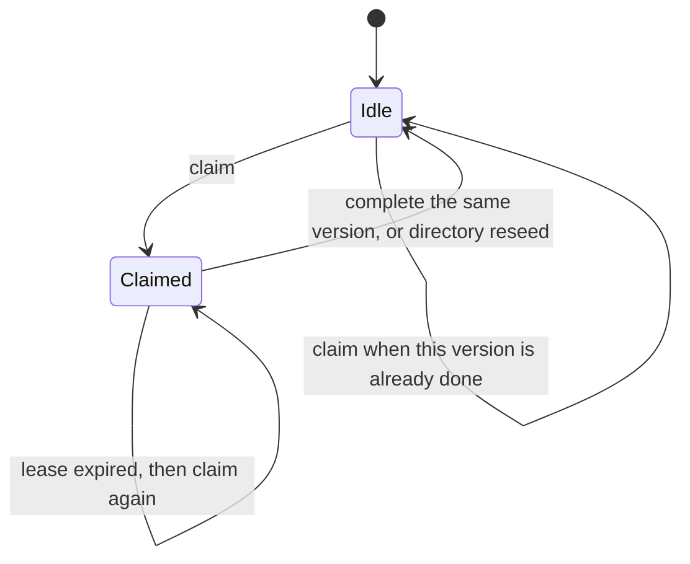

### Platform / flag differences

`wikiSeedEnabled` (`wiki/seed.ts:12`) requires `ENVIRONMENT === "dev"` and `WIKI_SEED` not `off`. Otherwise the result is `off` and the claim methods are not called. The flag is a guard in front of the function, not inside `seedClaim`.

## 19. Agent turn round

- Purpose: One assistant turn runs at most `AGENT_LIMITS.maxRounds` model rounds, spends a reservation per round, and either answers, fails, or runs tools and continues.
- Code: `src/state/agent-turn.ts` (`transitionAgentTurn`). Tests: `harness/tests/agent-turn-machine.test.ts`. `runLoop` calls the model and the tools, then applies the step.
- Persisted: no. There is no codec. `runLoop` does not write the turn.
- What changed: the stop-reason chain is the reducer. End, max tokens, an empty tool list, an unknown stop, and tools on the last round take the same branches as before. Tool results still count toward the turn cap, including calls that return an error. A stop event after the turn has answered is rejected and logged. The answer text stays on the round result. The reducer carries only the truncated flag.

### States

| State | Data carried | Meaning |
|---|---|---|
| round | round number, tool calls so far | About to reserve and call the model |
| tools | tool uses from this round | Need to execute tools and append messages |
| answered | truncated flag | Last round's text is the answer. The text itself stays on the round result |
| failed | `ai_budget_exhausted` or `ai_unavailable` | Stop |

### Events

| Event | Source |
|---|---|
| budget_denied | `reserve` returned null |
| upstream_failed | `streamRound` not ok |
| stop_end | `end_turn` or `stop_sequence` |
| stop_max_tokens | `max_tokens` |
| stop_tool | `tool_use` |
| stop_other | refusal, `pause_turn`, unknown, or `tool_use` with an empty list |
| tools_finished | Tool results appended |

### Transitions

| From | Event | Guard | To | Side effects |
|---|---|---|---|---|
| round | budget_denied | — | failed budget | no model call |
| round | upstream_failed | — | failed unavailable | settle already ran |
| round | stop_end | — | answered, not truncated | return |
| round | stop_max_tokens | — | answered, truncated | return |
| round | stop_other | — | failed unavailable | return |
| round | stop_tool | round is the last allowed, or tool list is empty | failed unavailable | tools are not run |
| round | stop_tool | an earlier round, and at least one tool use | tools | per-call limits stay in the tool map. They do not change the turn status |
| round | stop_tool | count is not a non-negative integer | rejected | the count is not logged |
| tools | tools_finished | `ran` is an integer from 0 through the tool-use count | round, round + 1, calls increased by `ran` | messages gain the assistant block and the tool results |
| tools | tools_finished | `ran` is larger than the tool-use count, or not an integer | rejected | nothing is added |

`startAgentTurn` with a max below 1 is already failed, so the loop does not run. With `AGENT_LIMITS.maxRounds >= 1` every real turn still leaves through a terminal state. A tool that runs and returns an error still counts. A use the loop refuses as over the cap does not: `tools_finished` adds `ran`, which is `toolUsesCounted`, not the whole list. An unhandled event is logged by `event.type` only.

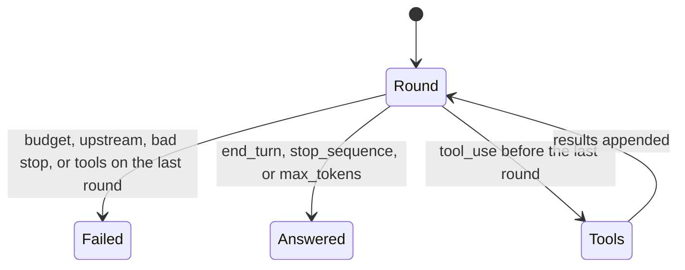

### Platform / flag differences

None. Limits come from `AGENT_LIMITS` in `ai/config.ts:77`.

## 20. SSE content assembly

- Purpose: Rebuild one assistant message from Anthropic server-sent events so the next round can send it back unchanged.
- Code: `src/state/sse-assembly.ts` (`transitionSse`). Tests: `harness/tests/sse-assembly-machine.test.ts`. `streamRound` reads the socket and runs `text` and `tool` effects.
- Persisted: no. There is no codec, so block text and tool input are not serialized. `streamRound` keeps the assembly for this request only.
- What changed: the frame switch is the reducer. Block text, tool JSON, thinking, signatures, citations, token sums, and the callbacks follow the old rules. A frame that used to return false is the `broken` state, and the round still fails with `upstream_error`. A frame after that is rejected and logged.

### States

| State | Data carried | Meaning |
|---|---|---|
| assembling | blocks, partial JSON, invalid indexes, model, stop reason, token counts, stopped flag | Accepting events |
| broken | — | This event cannot be applied. The round fails |

`onEvent` returns false for `broken` and for an illegal event. The read loop then fails the round.

### Events

| Event | Source |
|---|---|
| message_start, content_block_start, content_block_delta, content_block_stop, message_delta, message_stop | SSE `data:` JSON |
| error | Provider error event |
| other | `ping` and unknown types. Ignored, return true (208–209) |

### Transitions

| From | Event | Guard | To | Side effects |
|---|---|---|---|---|
| assembling | message_start | — | assembling | set model and input-token sum, including cache tokens |
| assembling | content_block_start | `hasBlockType` | assembling | copy the block. `tool` effect when the type is `tool_use` or `server_tool_use` |
| assembling | content_block_start | type missing | broken | round fails |
| assembling | content_block_delta | `canApplyDelta` | assembling | append text, JSON, thinking, signature, or citation. `text` effect for text. Other delta types are ignored |
| assembling | content_block_delta | block or delta missing | broken | round fails |
| assembling | content_block_stop | — | assembling | parse partial JSON if this index has a buffer. Invalid JSON marks the index. A stop for a missing block still returns true |
| assembling | message_delta | — | assembling | stop reason and usage |
| assembling | message_stop | — | assembling, stopped | the read loop may exit |
| assembling | error | — | broken | round fails |
| assembling | other | — | assembling | ignored |

A delta for an index that never started fails the whole round. There is no "skip this block" transition. `sseIndex` treats non-positive indexes as 0, so a missing index and index 0 share a slot. `hasBlockType` and `canApplyDelta` are the guards.

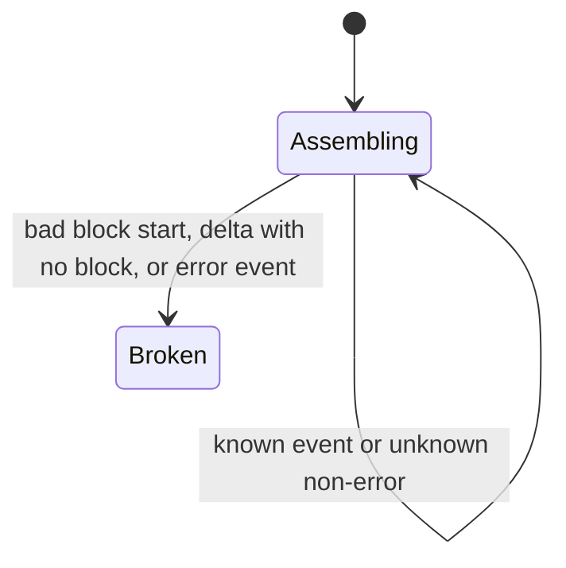

### Platform / flag differences

None.

## 29. Wiki job queue

- Purpose: A wiki job waits, runs, finishes, or is given up.
- Code: no reducer yet. `MAX_ATTEMPTS` is 3 (`wiki/store.ts:54`). `wikiJobsDue` (`:618`) reclaims a `running` row whose claim is older than five minutes.
- Persisted: yes, `wiki_jobs.state`.
- What changed: nothing. Documented after review. Medium, and still LATER. Not part of the approved High order.

States are `pending`, `running`, `done`, and `failed`. A due `pending` row becomes `running` and `attempts` increases. A `running` row older than five minutes returns to `pending`, or becomes `failed` when `attempts` is already 3. `done` and `failed` rows are deleted after 14 days.

## 30. Erasure / rights

- Purpose: A configure-role erasure removes a person, remembers that removal, and applies it again after a restore.
- Code: no reducer yet. `POST /rights/erase` (`ops-admin.ts:166`). The second person is machine 4 (`requestSecond` at 178). `eraseSubject` either finishes or the route returns 502 `erase_incomplete` (`:189`) with no stored status for that failure. Tombstones are `tombstoneAdd` (`tenant-policy.ts:979`). A restore calls `reapplyErasures` (`ops-internal.ts:188`).
- Persisted: the tombstone row. The 502 path stores nothing.
- What changed: nothing. High, and privacy. Last in the approved High order.

## 31. Outbox dispatched flag

Not a machine. `outbox.dispatched` is created as `INTEGER NOT NULL DEFAULT 0` (`workspace.ts:181`). `outbox` (`:617`) inserts a row and does not set the flag. `outboxPending` (`:671`) reads `WHERE dispatched = 0`. No statement in this archive sets `dispatched` to 1, so the flag has a column and no transition.

## 21–28. Not machines

**21 Home screen.** The UI that would hold loading, empty, error, stale, partial, and populated is not in the archive. Server values that sound similar are #24 and the callout templates in `ai/planner.ts:27`.

**22 Recorder / LaunchAgent.** No source, plist, or comment. Evidence in the section above.

**23 Calendar refresh.** No job, cursor, or status. `isCalendarDay` is a predicate.

**24 Coverage and account health.** `accountStatus` (`brains/insights.ts:610`) maps age in days to `active` (≤ 30), `watch` (≤ 90), or `dormant`. `brainCoverage` (622) and `pageCoverage` (640) map a count to `missing`, `low`, or `ok` against a fixed target. Nothing is stored and nothing transitions. Three labels with no ordering rule are a mapping.

**25 AI processor gate.** `aiState` (`ai/config.ts:54`) returns `disabled`, `contract_missing`, `not_configured`, or `ready`. The order is fixed and fail-closed. It is already one discriminated union of the environment. It is not a lifecycle: the next request computes it again. No persisted status.

**26 Import classifier.** A pure function from text to `skip`, `ask`, or `ingest`. Machine 11 consumes the verdict.

**27 Connector upsert.** `connector.ts` parses items and writes sources. Fail-closed access checks are predicates. The connector worker's own sync loop is not in this repo (`RECOVERY.md`).

**28 Session-report publish flag.** `brains/push.ts:212` sets `publishDirect` from `personal && publication === "direct"`. One boolean, no later states, no retry. The proposal it creates is machine 8.

Also reviewed and not listed as machines: notification `read` (one boolean), principal `active` (one boolean in the security journal), and `hit` rate windows (a counter, not a lifecycle of named states).
